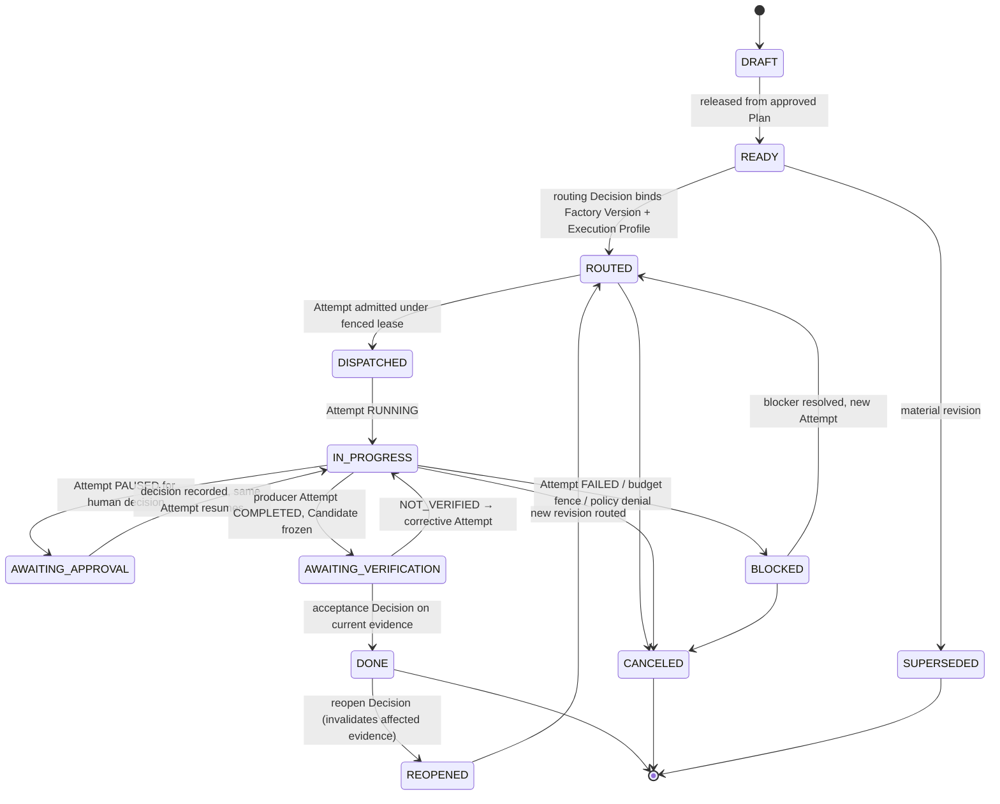

# Work Order

`fdlc://v1/work-order` · Family A (Intent) · Delivery Loop steps 3–7 (released at **Plan**, bound at **Route**, executed, verified, accepted)

## Purpose

A Work Order is the bounded, authorized unit of work: scope, risk class, authority envelope, verification contract, change budget, negative constraints, and the bound Factory Version and Execution Profile. It is the contract between human intent and factory execution, and the unit of acceptance. A Work Order contains Tasks; a Task completing never accepts the Work Order.

## Identity

| Rule | Value |
|---|---|
| Type URI | `fdlc://v1/work-order` |
| Instance id | Worked-example form `WO-<intent>-<seq>` (`WO-104-01`). Prose spelling "Work Order"; code identifier `WorkOrder`. |
| Mutability | Revisioned. `revisionNumber` increments on any material change; the contract projection of each revision is immutable. |
| Digest | `digest` = SHA-256 over canonical JSON of the revision's contract projection: `{kind, desiredOutcome, repository, riskClass, autonomyLevel, authorityEnvelope, acceptanceCriteria, negativeConstraints, dataBoundaries, changeBudget, verificationContract, budgets}`. `verificationContractDigest` is the digest of `verificationContract` alone; the Verification Subject binds it. |

## Fields

| Field | Type | Req | Description |
|---|---|---|---|
| `schemaVersion`, `type`, `id`, `namespace` | — | MUST | Common identity. |
| `intentId`, `planId`, `planDigest`, `blueprintId` | Id, Digest | MUST | Lineage to the approved Plan revision and blueprint. |
| `qualityContractDigest`, `specificationDigest` | Digest | MUST / SHOULD | Frozen definition of success. |
| `revisionNumber` | int | MUST | Current revision. |
| `kind` | SOFTWARE_CHANGE / VERIFICATION / AUTOMATION | MUST | — |
| `role` | PRODUCER / VERIFIER | MUST | Verifier Work Orders are non-mutating. |
| `title`, `desiredOutcome`, `context` | string | MUST / SHOULD | — |
| `isMutating` | bool | MUST | Serial-mutation policy applies to mutating Work Orders. |
| `repository` | object | MUST | `repositoryId`, `provider`, `name`, `baseRef`, `branchStrategy`, `dataClassification`, `codeScopes[]` (governed path allowlists). |
| `riskClass`, `riskReasons[]` | RiskClass | MUST / SHOULD | Server-owned minimum. |
| `autonomyLevel` | L0–L5 | MUST | Effective autonomy = min(factory, objective, work order, policy, trust). CRITICAL risk caps at L2. |
| `authorityEnvelope` | AuthorityEnvelope | MUST | `allowedActions[]`, `prohibitedActions[]`, `allowedCapabilityIds[]`, `credentialClasses[]`, `networkPolicyDigest`, `publicationAuthority: CONTROL_PLANE_ONLY`, `requiredDecisions[]`, `escalationConditions[]`. |
| `requirements[]` | Requirement | SHOULD | MUST/SHOULD, functional/non-functional. |
| `acceptanceCriteria[]` | AcceptanceCriterion | MUST (≥1) | `id`, `assertionId`, `givenWhenThen`, `verificationMethod`, `requiredEvidence[] {category, minimumCount, independenceLevel}`, `waiverAllowed`, `status`. |
| `negativeConstraints[]` | NegativeConstraint | MUST | Typed: PROTECTED_PATH, NO_AUTH_CHANGES, NO_PRODUCTION_ACCESS, NO_PLAINTEXT_SECRETS, NO_PUBLIC_API_CHANGES, NO_SCHEMA_CHANGES, NO_NEW_DEPENDENCIES, NO_TEST_REMOVAL, NO_ASSERTION_WEAKENING, NO_VERIFICATION_CONFIG_CHANGES, CUSTOM. |
| `dataBoundaries[]` | DataBoundary | SHOULD | SECRET, CREDENTIAL, PRODUCTION_DATA, PII, PROTECTED_FILE, RESTRICTED_SERVICE. |
| `changeBudget` | ChangeBudget | MUST | Files, lines, allowed/denied paths (denied overrides allowed), allowed/prohibited command classes, dependency/schema/migration/infrastructure flags. |
| `verificationContract` | VerificationContract | MUST | `enforcementMode`, `checks[]` (criteria → verifier capability), `requiredRisks[]`, `independence {required, minimumBoundary}`, `requireHumanReview`, `authorityPolicy` (which verdict-determining surfaces the candidate may touch), `verificationLevels[]`. |
| `verificationContractDigest` | Digest | MUST | — |
| `budgets` | object | MUST | `maxCost`, `maxAttempts`, `maxRuntimeMinutes`, `stopCondition`, optional `spendingFence`. |
| `binding` | object | MUST once ROUTED | `routingDecisionId`, `factoryVersionId/Digest`, `executionProfileId/Digest`, `verifierFactoryVersionId`, `pinned`, `boundAt`. |
| `tasks[]` | Task | SHOULD | Bounded operational units: `state` PENDING/READY/IN_PROGRESS/BLOCKED/DONE/FAILED/CANCELED, `dependsOn[]`, `attemptIds[]`. |
| `dependsOnWorkOrderIds[]` | Id | SHOULD | Objective-level dependencies. |
| `state` | enum | MUST | Lifecycle axis. |
| `verificationStatus` | PENDING / PASS / FAIL / WAIVED / STALE | MUST | Verification axis (derived). |
| `approvalStatus` | NOT_REQUIRED / PENDING / APPROVED / CONDITIONAL / REJECTED / REVISION_REQUESTED / EXPIRED / REVOKED | MUST | Approval axis (derived from Decisions). |
| `currentAttemptId`, `attemptIds[]`, `currentCandidateId`, `currentVerificationId` | Id | SHOULD | Newest lineage. |
| `acceptanceDecisionId`, `acceptedRevisionNumber` | Id, int | MUST when DONE | The single acceptance boundary. |
| `revisionMateriality` | NO_ACTION / REVERIFICATION / REAPPROVAL / BOTH / FULL_REOPEN | SHOULD | Effect of the latest revision on existing evidence and approvals. |
| `supersededById`, `supersedesId` | Id | MAY | Supersession lineage. |
| `digest`, `createdAt`, `createdBy`, `updatedAt`, `releasedAt`, `idempotencyKey`, `history[]` | — | MUST / SHOULD | Common audit fields. |

## Lifecycle



Task sub-lifecycle: `PENDING → READY → IN_PROGRESS → DONE | FAILED | BLOCKED | CANCELED`. A failed Attempt does not make its Task terminal while recovery is active; `FAILED` is reached only when retry policy is exhausted or a human stops it.

| Transition | Who | MUST record |
|---|---|---|
| `DRAFT → READY` | Control plane on plan approval (idempotent) | `planDigest`, `qualityContractDigest`, `verificationContractDigest`, `releasedAt` |
| `READY → ROUTED` | Factory Router (policy) or human pin | Decision (kind `routing`): eligibility filters, ranked candidates, bound identities |
| `ROUTED → DISPATCHED` | Control plane | Decision (kind `admission`) for the Attempt; lease |
| `IN_PROGRESS → AWAITING_VERIFICATION` | Control plane (derived from Attempt COMPLETED) | Candidate id, subject digest |
| `AWAITING_VERIFICATION → DONE` | **Only** the acceptance boundary: human (HIGH/CRITICAL) or policy within envelope (LOW/MEDIUM) | Decision (kind `acceptance`), currentness result recomputed at decision time, `acceptedRevisionNumber` |
| `DONE → REOPENED` | Human with reopen permission | Reopen Decision; list of invalidated receipts and approvals |
| revision | Owner or authorized human | `revisionMateriality`; receipts/approvals invalidated per policy |

## Invariants

- A Work Order MUST be created only from an approved Plan revision. Its existence MUST NOT make it ready for execution.
- Execution MUST use the current approved revision. Criterion and requirement ids MUST be unique per revision.
- Every required acceptance criterion MUST map to ≥1 evidence requirement, and every mandatory check MUST map to a verifier capability. "Absence of an enforced contract cannot be presented as verified." (`verification-first-domain-contracts.md:71-78`)
- Denied paths MUST override allowed paths. Command classes not in `allowedCommandClasses` MUST be treated as prohibited.
- `authorityEnvelope.publicationAuthority` MUST be `CONTROL_PLANE_ONLY`. A Work Order MUST NOT grant an agent publication, merge, deploy, approve, or accept authority.
- `binding` MUST reference a Factory Version in state `ACTIVE` (or `RESTRICTED` with this scope still permitted) and an Execution Profile whose admission is eligible for the target environment at bind time. The binding MUST NOT change without a new routing Decision.
- Risk class `CRITICAL` MUST NOT be auto-routed; `autonomyLevel` MUST NOT exceed L2.
- `DONE` MUST be reached only through an acceptance Decision that recomputes currentness at decision time, requires zero active Attempts, and references the exact current Candidate and Verification. "Passing execution and verification only make a WorkOrder eligible for acceptance; they do not accept it." (Mission Control README:218-219)
- "Task completion does not accept a WorkOrder, and WorkOrder completion does not accept a Mission." (`docs/OVERVIEW.md:432-433`)
- A material revision MUST invalidate affected receipts and approvals according to `revisionMateriality`; it MUST NOT carry stale proof forward.
- A hard budget with unknown estimated cost MUST fail closed at routing and admission.

## Evidence requirements

| Transition | Evidence |
|---|---|
| Release | Plan approval Decision; Quality Contract digest |
| Route | Routing Decision with eligibility filters and rejected candidates |
| Dispatch | Admission Decision; execution manifest digest; lease |
| Awaiting verification | Candidate with scope reconciliation `IN_SCOPE` and `verificationAuthorityStatus` |
| Acceptance | Verification `VERIFIED` with `independence.passed`, receipt `PASSED` and unexpired, Quality Gate `ELIGIBLE`, provider head match, acceptance Decision |
| Reopen | Reopen Decision; invalidated dependents list |

## Extension points

- `x-` fields at top level and on `acceptanceCriteria[]`, `negativeConstraints[]`, `tasks[]`.
- `negativeConstraints[].type: CUSTOM` with `x-type` for organization-specific constraint families.
- `authorityEnvelope.allowedActions`/`prohibitedActions` are closed enums. Additional actions MUST be expressed through `allowedCapabilityIds` and tool grants, not by extending the enum.

## Mission Control mapping

| FDLC | Mission Control | Status | Divergence |
|---|---|---|---|
| Work Order | `workOrders` (`convex/schema.ts:2422`); `convex/workOrders.ts` | Available (Qualified) | Direct; three status axes match (`state`, `verificationStatus`, `approvalStatus`). |
| `ROUTED` state | none; routing happens at dispatch and is frozen on the Attempt (`executionRoutingSnapshot`, `routingDecisionId`) | Available (routing), Proposed (state) | FDLC makes Route (step 4) observable as a state. MC's `executionRoutingPin` corresponds to `binding.pinned`. |
| `acceptanceCriteria`, `negativeConstraints`, `dataBoundaries`, `changeBudget` | same names, `convex/lib/workOrderSpecificationValidators.ts` | Available | Direct; FDLC adds `ANALYSIS` method and `PERFORMANCE`/`ACCESSIBILITY` check categories. |
| `verificationContract` | v1/v2 validators (`workOrderSpecificationValidators.ts:179-203`) | Available | Direct; MC v2 `minimumBoundary` is only `SEPARATE_ATTEMPT`; FDLC adds `SEPARATE_FACTORY`, `SEPARATE_MODEL_FAMILY`. |
| `authorityEnvelope` | distributed across `allowedTools`, `policyEnvelopeId`, prompt text, harness manifest `prohibitedAuthorities` | Partial | FDLC consolidates into one field. |
| `tasks[]` | `tasks` table (legacy 10-state Kanban), `tasks.workOrderId` | Available (legacy) | FDLC defines a 7-state Task; MC's actor-gated transition matrix is a pattern, not the spec. |
| `revisionMateriality` | `workOrderRevisions` materiality (`schema.ts:210-216`) | Available | Direct. |
| Acceptance boundary | `workOrders.accept` (`convex/workOrders.ts:5279-5589`), human-only | Available | Direct; MC accepts only `HUMAN` actors. FDLC permits policy acceptance for LOW/MEDIUM within envelope (Proposed in MC). |

## JSON Schema

```json
{
  "$schema": "https://json-schema.org/draft/2020-12/schema",
  "$id": "https://fdlc.ai/schemas/v1/work-order.schema.json",
  "title": "FDLC Work Order",
  "description": "The bounded, authorized unit of work: scope, risk class, authority envelope, verification contract, change budget, negative constraints, bound Factory Version + Execution Profile. Contains Tasks.",
  "type": "object",
  "properties": {
    "schemaVersion": {
      "type": "string",
      "const": "1.0"
    },
    "type": {
      "type": "string",
      "const": "fdlc://v1/work-order"
    },
    "id": {
      "$ref": "#/$defs/Id"
    },
    "namespace": {
      "$ref": "#/$defs/Namespace"
    },
    "intentId": {
      "$ref": "#/$defs/Id"
    },
    "planId": {
      "$ref": "#/$defs/Id"
    },
    "planDigest": {
      "$ref": "#/$defs/Digest"
    },
    "blueprintId": {
      "$ref": "#/$defs/Id"
    },
    "qualityContractDigest": {
      "$ref": "#/$defs/Digest"
    },
    "specificationDigest": {
      "$ref": "#/$defs/Digest"
    },
    "revisionNumber": {
      "type": "integer",
      "minimum": 1
    },
    "kind": {
      "type": "string",
      "enum": [
        "SOFTWARE_CHANGE",
        "VERIFICATION",
        "AUTOMATION"
      ]
    },
    "role": {
      "type": "string",
      "enum": [
        "PRODUCER",
        "VERIFIER"
      ]
    },
    "title": {
      "type": "string",
      "minLength": 1
    },
    "desiredOutcome": {
      "type": "string",
      "minLength": 1
    },
    "context": {
      "type": "string"
    },
    "isMutating": {
      "type": "boolean"
    },
    "repository": {
      "type": "object",
      "properties": {
        "repositoryId": {
          "$ref": "#/$defs/Id"
        },
        "provider": {
          "type": "string"
        },
        "name": {
          "type": "string"
        },
        "baseRef": {
          "type": "string"
        },
        "branchStrategy": {
          "type": "string"
        },
        "dataClassification": {
          "type": "string",
          "enum": [
            "PUBLIC",
            "INTERNAL",
            "CONFIDENTIAL",
            "RESTRICTED"
          ]
        },
        "codeScopes": {
          "type": "array",
          "items": {
            "$ref": "#/$defs/CodeScope"
          }
        }
      },
      "required": [
        "repositoryId",
        "name",
        "baseRef",
        "codeScopes"
      ],
      "additionalProperties": false
    },
    "riskClass": {
      "$ref": "#/$defs/RiskClass"
    },
    "riskReasons": {
      "type": "array",
      "items": {
        "type": "string"
      }
    },
    "autonomyLevel": {
      "$ref": "#/$defs/AutonomyLevel"
    },
    "authorityEnvelope": {
      "$ref": "#/$defs/AuthorityEnvelope"
    },
    "requirements": {
      "type": "array",
      "items": {
        "$ref": "#/$defs/Requirement"
      }
    },
    "acceptanceCriteria": {
      "type": "array",
      "minItems": 1,
      "items": {
        "$ref": "#/$defs/AcceptanceCriterion"
      }
    },
    "constraints": {
      "type": "array",
      "items": {
        "type": "string"
      }
    },
    "negativeConstraints": {
      "type": "array",
      "items": {
        "$ref": "#/$defs/NegativeConstraint"
      }
    },
    "dataBoundaries": {
      "type": "array",
      "items": {
        "$ref": "#/$defs/DataBoundary"
      }
    },
    "changeBudget": {
      "$ref": "#/$defs/ChangeBudget"
    },
    "verificationContract": {
      "$ref": "#/$defs/VerificationContract"
    },
    "verificationContractDigest": {
      "$ref": "#/$defs/Digest"
    },
    "budgets": {
      "type": "object",
      "properties": {
        "maxCost": {
          "$ref": "#/$defs/Money"
        },
        "maxAttempts": {
          "type": "integer",
          "minimum": 1
        },
        "maxRuntimeMinutes": {
          "type": "integer",
          "minimum": 1
        },
        "stopCondition": {
          "type": "string"
        },
        "spendingFence": {
          "type": "object",
          "properties": {
            "fencedAt": {
              "$ref": "#/$defs/Timestamp"
            },
            "reason": {
              "type": "string"
            }
          },
          "required": [
            "fencedAt",
            "reason"
          ],
          "additionalProperties": false
        }
      },
      "required": [
        "maxCost",
        "maxAttempts",
        "maxRuntimeMinutes",
        "stopCondition"
      ],
      "additionalProperties": false
    },
    "binding": {
      "type": "object",
      "description": "Result of Route (Delivery Loop step 4). Frozen once ROUTED; a change requires a new routing Decision.",
      "properties": {
        "routingDecisionId": {
          "$ref": "#/$defs/Id"
        },
        "factoryManifestId": {
          "$ref": "#/$defs/Id"
        },
        "factoryVersionId": {
          "$ref": "#/$defs/Id"
        },
        "factoryVersionDigest": {
          "$ref": "#/$defs/Digest"
        },
        "executionProfileId": {
          "$ref": "#/$defs/Id"
        },
        "executionProfileDigest": {
          "$ref": "#/$defs/Digest"
        },
        "verifierFactoryVersionId": {
          "$ref": "#/$defs/Id"
        },
        "pinned": {
          "type": "boolean"
        },
        "boundAt": {
          "$ref": "#/$defs/Timestamp"
        }
      },
      "required": [
        "routingDecisionId",
        "factoryVersionId",
        "factoryVersionDigest",
        "executionProfileId",
        "executionProfileDigest",
        "boundAt"
      ],
      "additionalProperties": false
    },
    "tasks": {
      "type": "array",
      "items": {
        "$ref": "#/$defs/Task"
      }
    },
    "dependsOnWorkOrderIds": {
      "type": "array",
      "items": {
        "$ref": "#/$defs/Id"
      }
    },
    "state": {
      "type": "string",
      "enum": [
        "DRAFT",
        "READY",
        "ROUTED",
        "DISPATCHED",
        "IN_PROGRESS",
        "BLOCKED",
        "AWAITING_APPROVAL",
        "AWAITING_VERIFICATION",
        "REOPENED",
        "DONE",
        "CANCELED",
        "SUPERSEDED"
      ]
    },
    "verificationStatus": {
      "type": "string",
      "enum": [
        "PENDING",
        "PASS",
        "FAIL",
        "WAIVED",
        "STALE"
      ]
    },
    "approvalStatus": {
      "type": "string",
      "enum": [
        "NOT_REQUIRED",
        "PENDING",
        "APPROVED",
        "CONDITIONAL",
        "REJECTED",
        "REVISION_REQUESTED",
        "EXPIRED",
        "REVOKED"
      ]
    },
    "currentAttemptId": {
      "$ref": "#/$defs/Id"
    },
    "attemptIds": {
      "type": "array",
      "items": {
        "$ref": "#/$defs/Id"
      }
    },
    "currentCandidateId": {
      "$ref": "#/$defs/Id"
    },
    "currentVerificationId": {
      "$ref": "#/$defs/Id"
    },
    "acceptanceDecisionId": {
      "$ref": "#/$defs/Id"
    },
    "acceptedRevisionNumber": {
      "type": "integer",
      "minimum": 1
    },
    "revisionMateriality": {
      "type": "string",
      "enum": [
        "NO_ACTION",
        "REVERIFICATION",
        "REAPPROVAL",
        "BOTH",
        "FULL_REOPEN"
      ]
    },
    "supersededById": {
      "$ref": "#/$defs/Id"
    },
    "supersedesId": {
      "$ref": "#/$defs/Id"
    },
    "blockingIssue": {
      "type": "string"
    },
    "requiredHumanAction": {
      "type": "string"
    },
    "digest": {
      "$ref": "#/$defs/Digest",
      "description": "Digest of the revision's contract projection (kind, desiredOutcome, repository, riskClass, autonomyLevel, authorityEnvelope, acceptanceCriteria, negativeConstraints, dataBoundaries, changeBudget, verificationContract, budgets)."
    },
    "createdAt": {
      "$ref": "#/$defs/Timestamp"
    },
    "createdBy": {
      "$ref": "#/$defs/Actor"
    },
    "updatedAt": {
      "$ref": "#/$defs/Timestamp"
    },
    "releasedAt": {
      "$ref": "#/$defs/Timestamp"
    },
    "idempotencyKey": {
      "type": "string"
    },
    "history": {
      "type": "array",
      "items": {
        "$ref": "#/$defs/Transition"
      }
    }
  },
  "required": [
    "schemaVersion",
    "type",
    "id",
    "namespace",
    "intentId",
    "planId",
    "planDigest",
    "blueprintId",
    "qualityContractDigest",
    "revisionNumber",
    "kind",
    "role",
    "title",
    "desiredOutcome",
    "isMutating",
    "repository",
    "riskClass",
    "autonomyLevel",
    "authorityEnvelope",
    "acceptanceCriteria",
    "negativeConstraints",
    "changeBudget",
    "verificationContract",
    "verificationContractDigest",
    "budgets",
    "state",
    "verificationStatus",
    "approvalStatus",
    "digest",
    "createdAt",
    "createdBy",
    "updatedAt"
  ],
  "allOf": [
    {
      "if": {
        "properties": {
          "state": {
            "enum": [
              "ROUTED",
              "DISPATCHED",
              "IN_PROGRESS",
              "AWAITING_APPROVAL",
              "AWAITING_VERIFICATION",
              "DONE"
            ]
          }
        }
      },
      "then": {
        "required": [
          "binding"
        ]
      }
    },
    {
      "if": {
        "properties": {
          "state": {
            "const": "DONE"
          }
        }
      },
      "then": {
        "required": [
          "acceptanceDecisionId",
          "acceptedRevisionNumber",
          "currentCandidateId",
          "currentVerificationId"
        ],
        "properties": {
          "verificationStatus": {
            "enum": [
              "PASS",
              "WAIVED"
            ]
          },
          "approvalStatus": {
            "enum": [
              "NOT_REQUIRED",
              "APPROVED",
              "CONDITIONAL"
            ]
          }
        }
      }
    },
    {
      "if": {
        "properties": {
          "riskClass": {
            "const": "CRITICAL"
          }
        }
      },
      "then": {
        "properties": {
          "autonomyLevel": {
            "enum": [
              "L0",
              "L1",
              "L2"
            ]
          }
        }
      }
    }
  ],
  "$defs": {
    "Id": {
      "type": "string",
      "minLength": 1,
      "maxLength": 200,
      "pattern": "^[A-Za-z0-9][A-Za-z0-9._:/@-]*$",
      "description": "Instance identifier. Unique within the issuing namespace; combined with `namespace` it is globally unique."
    },
    "ArtifactUri": {
      "type": "string",
      "pattern": "^fdlc://v1/(intent|specification|plan|work-order|factory-manifest|factory-version|execution-profile|capability-manifest|qualification-record|context-package|attempt|candidate|evidence|verification|decision|release|outcome|learning-signal|improvement-candidate)(/[A-Za-z0-9][A-Za-z0-9._:@-]*)?$",
      "description": "Artifact type URI (`fdlc://v1/<artifact>`), optionally suffixed with an instance id."
    },
    "Namespace": {
      "type": "string",
      "format": "uri",
      "description": "URI of the issuing control plane or organization. Scopes every `id` in this record."
    },
    "Digest": {
      "type": "string",
      "pattern": "^sha256:[a-f0-9]{64}$",
      "description": "SHA-256 over the RFC 8785 (JCS) canonical JSON of the digested projection."
    },
    "GitSha": {
      "type": "string",
      "pattern": "^[a-f0-9]{40}$|^[a-f0-9]{64}$",
      "description": "Lowercase full Git object id (SHA-1 or SHA-256 repository)."
    },
    "Timestamp": {
      "type": "string",
      "format": "date-time",
      "description": "RFC 3339 timestamp in UTC."
    },
    "Semver": {
      "type": "string",
      "pattern": "^(0|[1-9]\\d*)\\.(0|[1-9]\\d*)\\.(0|[1-9]\\d*)(-[0-9A-Za-z.-]+)?(\\+[0-9A-Za-z.-]+)?$"
    },
    "RiskClass": {
      "type": "string",
      "enum": [
        "LOW",
        "MEDIUM",
        "HIGH",
        "CRITICAL"
      ]
    },
    "AutonomyLevel": {
      "type": "string",
      "enum": [
        "L0",
        "L1",
        "L2",
        "L3",
        "L4",
        "L5"
      ],
      "description": "HITL spectrum position. Effective autonomy is min(factory, objective, work order, policy, trust)."
    },
    "Actor": {
      "type": "object",
      "description": "Attributable identity. `identitySource` says how the control plane established it; never inferred from a client label.",
      "properties": {
        "kind": {
          "type": "string",
          "enum": [
            "human",
            "policy",
            "service",
            "agent",
            "system"
          ]
        },
        "id": {
          "$ref": "#/$defs/Id"
        },
        "identitySource": {
          "type": "string",
          "enum": [
            "authenticated",
            "workload-identity",
            "service-command",
            "development-fallback"
          ]
        },
        "displayName": {
          "type": "string"
        },
        "delegationRef": {
          "$ref": "#/$defs/Id",
          "description": "Reference to the delegation record that grants this actor its authority."
        }
      },
      "required": [
        "kind",
        "id",
        "identitySource"
      ],
      "additionalProperties": false
    },
    "Ref": {
      "type": "object",
      "description": "Reference to another FDLC artifact instance, optionally pinned to a digest.",
      "properties": {
        "type": {
          "$ref": "#/$defs/ArtifactUri"
        },
        "id": {
          "$ref": "#/$defs/Id"
        },
        "digest": {
          "$ref": "#/$defs/Digest"
        },
        "revisionNumber": {
          "type": "integer",
          "minimum": 1
        }
      },
      "required": [
        "type",
        "id"
      ],
      "additionalProperties": false
    },
    "Money": {
      "type": "object",
      "properties": {
        "amount": {
          "type": "number",
          "minimum": 0
        },
        "currency": {
          "type": "string",
          "pattern": "^[A-Z]{3}$"
        }
      },
      "required": [
        "amount",
        "currency"
      ],
      "additionalProperties": false
    },
    "CostRecord": {
      "type": "object",
      "description": "Cost with an honesty class. UNKNOWN cost stays UNKNOWN; implementations MUST NOT invent zeroes.",
      "properties": {
        "status": {
          "type": "string",
          "enum": [
            "MEASURED",
            "ESTIMATED",
            "UNKNOWN"
          ]
        },
        "amount": {
          "type": "number",
          "minimum": 0
        },
        "currency": {
          "type": "string",
          "pattern": "^[A-Z]{3}$"
        },
        "coverage": {
          "type": "number",
          "minimum": 0,
          "maximum": 1,
          "description": "Fraction of contributing cost items that were measured."
        },
        "reason": {
          "type": "string"
        }
      },
      "required": [
        "status"
      ],
      "additionalProperties": false
    },
    "Transition": {
      "type": "object",
      "description": "Audit record of one authoritative state transition. Every field listed here MUST be recorded.",
      "properties": {
        "transitionId": {
          "$ref": "#/$defs/Id"
        },
        "subjectId": {
          "$ref": "#/$defs/Id"
        },
        "priorVersion": {
          "type": "integer",
          "minimum": 0
        },
        "fromState": {
          "type": "string"
        },
        "toState": {
          "type": "string"
        },
        "actor": {
          "$ref": "#/$defs/Actor"
        },
        "reason": {
          "type": "string"
        },
        "policyVersion": {
          "type": "string"
        },
        "idempotencyKey": {
          "type": "string"
        },
        "occurredAt": {
          "$ref": "#/$defs/Timestamp"
        },
        "requiredEvidenceIds": {
          "type": "array",
          "items": {
            "$ref": "#/$defs/Id"
          }
        },
        "decisionId": {
          "$ref": "#/$defs/Id"
        },
        "invalidatedDependents": {
          "type": "array",
          "items": {
            "$ref": "#/$defs/Ref"
          }
        }
      },
      "required": [
        "subjectId",
        "fromState",
        "toState",
        "actor",
        "reason",
        "idempotencyKey",
        "occurredAt"
      ],
      "additionalProperties": false
    },
    "ArtifactRef": {
      "type": "object",
      "description": "Content-addressed reference to a stored artifact (diff, log, screenshot, bundle).",
      "properties": {
        "artifactId": {
          "$ref": "#/$defs/Id"
        },
        "kind": {
          "type": "string"
        },
        "mediaType": {
          "type": "string"
        },
        "digest": {
          "$ref": "#/$defs/Digest"
        },
        "sizeBytes": {
          "type": "integer",
          "minimum": 0
        },
        "storageRef": {
          "type": "string"
        }
      },
      "required": [
        "artifactId",
        "digest"
      ],
      "additionalProperties": false
    },
    "CodeScope": {
      "type": "object",
      "properties": {
        "id": {
          "$ref": "#/$defs/Id"
        },
        "includePaths": {
          "type": "array",
          "minItems": 1,
          "items": {
            "type": "string"
          }
        },
        "excludePaths": {
          "type": "array",
          "items": {
            "type": "string"
          }
        }
      },
      "required": [
        "id",
        "includePaths"
      ],
      "additionalProperties": false
    },
    "AuthorityEnvelope": {
      "type": "object",
      "description": "What this Work Order may cause to happen. Capability ≠ permission ≠ authority; this is the authority grant.",
      "properties": {
        "allowedActions": {
          "type": "array",
          "items": {
            "type": "string",
            "enum": [
              "READ_REPOSITORY",
              "MODIFY_WORKTREE",
              "RUN_TESTS",
              "RUN_BUILD",
              "INSTALL_DEPENDENCIES",
              "NETWORK_EGRESS_ALLOWLIST",
              "PROPOSE_CANDIDATE",
              "REQUEST_HUMAN_DECISION"
            ]
          }
        },
        "prohibitedActions": {
          "type": "array",
          "items": {
            "type": "string",
            "enum": [
              "PUBLISH_BRANCH",
              "OPEN_PULL_REQUEST",
              "MERGE",
              "DEPLOY",
              "APPROVE",
              "ACCEPT",
              "MODIFY_VERIFICATION_CONFIG",
              "ACCESS_PRODUCTION",
              "ACCESS_SECRETS",
              "WIDEN_SCOPE"
            ]
          }
        },
        "allowedCapabilityIds": {
          "type": "array",
          "items": {
            "$ref": "#/$defs/Id"
          }
        },
        "credentialClasses": {
          "type": "array",
          "items": {
            "type": "string"
          }
        },
        "networkPolicyDigest": {
          "$ref": "#/$defs/Digest"
        },
        "publicationAuthority": {
          "type": "string",
          "const": "CONTROL_PLANE_ONLY"
        },
        "requiredDecisions": {
          "type": "array",
          "items": {
            "type": "object",
            "properties": {
              "kind": {
                "type": "string",
                "enum": [
                  "admission",
                  "acceptance",
                  "release-authorization",
                  "exception"
                ]
              },
              "actorKind": {
                "type": "string",
                "enum": [
                  "human",
                  "policy"
                ]
              },
              "role": {
                "type": "string"
              }
            },
            "required": [
              "kind",
              "actorKind"
            ],
            "additionalProperties": false
          }
        },
        "escalationConditions": {
          "type": "array",
          "items": {
            "type": "string"
          }
        }
      },
      "required": [
        "allowedActions",
        "prohibitedActions",
        "publicationAuthority",
        "requiredDecisions"
      ],
      "additionalProperties": false
    },
    "Requirement": {
      "type": "object",
      "properties": {
        "id": {
          "$ref": "#/$defs/Id"
        },
        "title": {
          "type": "string"
        },
        "description": {
          "type": "string"
        },
        "type": {
          "type": "string",
          "enum": [
            "FUNCTIONAL",
            "NON_FUNCTIONAL"
          ]
        },
        "priority": {
          "type": "string",
          "enum": [
            "MUST",
            "SHOULD"
          ]
        }
      },
      "required": [
        "id",
        "title",
        "type",
        "priority"
      ],
      "additionalProperties": false
    },
    "EvidenceRequirement": {
      "type": "object",
      "properties": {
        "category": {
          "type": "string"
        },
        "minimumCount": {
          "type": "integer",
          "minimum": 1
        },
        "independenceLevel": {
          "type": "string",
          "enum": [
            "ANY_VERIFICATION",
            "CANDIDATE_DEPENDENT_ALLOWED",
            "INDEPENDENT_REQUIRED"
          ]
        }
      },
      "required": [
        "category",
        "minimumCount",
        "independenceLevel"
      ],
      "additionalProperties": false
    },
    "AcceptanceCriterion": {
      "type": "object",
      "properties": {
        "id": {
          "$ref": "#/$defs/Id"
        },
        "title": {
          "type": "string"
        },
        "description": {
          "type": "string"
        },
        "assertionId": {
          "$ref": "#/$defs/Id"
        },
        "requirementIds": {
          "type": "array",
          "items": {
            "$ref": "#/$defs/Id"
          }
        },
        "givenWhenThen": {
          "type": "object",
          "properties": {
            "given": {
              "type": "string"
            },
            "when": {
              "type": "string"
            },
            "then": {
              "type": "string"
            }
          },
          "required": [
            "given",
            "when",
            "then"
          ],
          "additionalProperties": false
        },
        "verificationMethod": {
          "type": "string",
          "enum": [
            "COMMAND",
            "TEST",
            "BROWSER",
            "MANUAL",
            "CHECKLIST",
            "ANALYSIS"
          ]
        },
        "requiredEvidence": {
          "type": "array",
          "minItems": 1,
          "items": {
            "$ref": "#/$defs/EvidenceRequirement"
          }
        },
        "waiverAllowed": {
          "type": "boolean"
        },
        "status": {
          "type": "string",
          "enum": [
            "PENDING",
            "PASS",
            "FAIL",
            "WAIVED",
            "STALE"
          ]
        }
      },
      "required": [
        "id",
        "title",
        "requiredEvidence",
        "status"
      ],
      "additionalProperties": false
    },
    "NegativeConstraint": {
      "type": "object",
      "properties": {
        "id": {
          "$ref": "#/$defs/Id"
        },
        "type": {
          "type": "string",
          "enum": [
            "PROTECTED_PATH",
            "NO_AUTH_CHANGES",
            "NO_PRODUCTION_ACCESS",
            "NO_PLAINTEXT_SECRETS",
            "NO_PUBLIC_API_CHANGES",
            "NO_SCHEMA_CHANGES",
            "NO_NEW_DEPENDENCIES",
            "NO_TEST_REMOVAL",
            "NO_ASSERTION_WEAKENING",
            "NO_VERIFICATION_CONFIG_CHANGES",
            "CUSTOM"
          ]
        },
        "description": {
          "type": "string"
        },
        "paths": {
          "type": "array",
          "items": {
            "type": "string"
          }
        },
        "pattern": {
          "type": "string"
        }
      },
      "required": [
        "id",
        "type",
        "description"
      ],
      "additionalProperties": false
    },
    "DataBoundary": {
      "type": "object",
      "properties": {
        "id": {
          "$ref": "#/$defs/Id"
        },
        "kind": {
          "type": "string",
          "enum": [
            "SECRET",
            "CREDENTIAL",
            "PRODUCTION_DATA",
            "PII",
            "PROTECTED_FILE",
            "RESTRICTED_SERVICE"
          ]
        },
        "description": {
          "type": "string"
        },
        "paths": {
          "type": "array",
          "items": {
            "type": "string"
          }
        },
        "resources": {
          "type": "array",
          "items": {
            "type": "string"
          }
        }
      },
      "required": [
        "id",
        "kind",
        "description"
      ],
      "additionalProperties": false
    },
    "ChangeBudget": {
      "type": "object",
      "properties": {
        "maxFilesChanged": {
          "type": "integer",
          "minimum": 0
        },
        "maxLinesChanged": {
          "type": "integer",
          "minimum": 0
        },
        "allowedPaths": {
          "type": "array",
          "items": {
            "type": "string"
          }
        },
        "deniedPaths": {
          "type": "array",
          "items": {
            "type": "string"
          },
          "description": "Denied overrides allowed."
        },
        "allowedCommandClasses": {
          "type": "array",
          "items": {
            "$ref": "#/$defs/CommandClass"
          }
        },
        "prohibitedCommandClasses": {
          "type": "array",
          "items": {
            "$ref": "#/$defs/CommandClass"
          }
        },
        "allowDependencyChanges": {
          "type": "boolean"
        },
        "allowSchemaChanges": {
          "type": "boolean"
        },
        "allowMigrations": {
          "type": "boolean"
        },
        "allowInfrastructureChanges": {
          "type": "boolean"
        }
      },
      "required": [
        "maxFilesChanged",
        "maxLinesChanged",
        "allowedPaths",
        "deniedPaths",
        "allowedCommandClasses",
        "prohibitedCommandClasses",
        "allowDependencyChanges",
        "allowSchemaChanges",
        "allowMigrations",
        "allowInfrastructureChanges"
      ],
      "additionalProperties": false
    },
    "CommandClass": {
      "type": "string",
      "enum": [
        "BUILD",
        "TYPECHECK",
        "TEST",
        "LINT",
        "SECURITY_SCAN",
        "DEPENDENCY_SCAN",
        "MIGRATION",
        "INFRASTRUCTURE",
        "PRODUCTION_ACCESS",
        "SECRETS_ACCESS",
        "DESTRUCTIVE",
        "PUBLISH"
      ]
    },
    "VerificationCheck": {
      "type": "object",
      "properties": {
        "id": {
          "$ref": "#/$defs/Id"
        },
        "name": {
          "type": "string"
        },
        "category": {
          "type": "string",
          "enum": [
            "BUILD",
            "TYPECHECK",
            "UNIT_TEST",
            "INTEGRATION_TEST",
            "CONTRACT_TEST",
            "SECURITY",
            "SECRETS",
            "DEPENDENCY",
            "POLICY",
            "CHANGE_BUDGET",
            "ACCEPTANCE",
            "INDEPENDENT_REVIEW",
            "PERFORMANCE",
            "ACCESSIBILITY"
          ]
        },
        "verifierCapabilityId": {
          "$ref": "#/$defs/Id"
        },
        "mandatory": {
          "type": "boolean"
        },
        "acceptanceCriterionIds": {
          "type": "array",
          "items": {
            "$ref": "#/$defs/Id"
          }
        },
        "evidenceCategory": {
          "type": "string"
        },
        "command": {
          "type": "object",
          "properties": {
            "executable": {
              "type": "string"
            },
            "args": {
              "type": "array",
              "items": {
                "type": "string"
              }
            },
            "commandClass": {
              "$ref": "#/$defs/CommandClass"
            },
            "timeoutMs": {
              "type": "integer",
              "minimum": 1
            }
          },
          "required": [
            "executable",
            "args",
            "commandClass",
            "timeoutMs"
          ],
          "additionalProperties": false
        }
      },
      "required": [
        "id",
        "name",
        "category",
        "verifierCapabilityId",
        "mandatory",
        "acceptanceCriterionIds",
        "evidenceCategory"
      ],
      "additionalProperties": false
    },
    "VerificationContract": {
      "type": "object",
      "description": "Criteria → verifiers, independence rules, authority policy. Frozen at release; a change is a new revision.",
      "properties": {
        "contractVersion": {
          "type": "integer",
          "minimum": 1
        },
        "enforcementMode": {
          "type": "string",
          "enum": [
            "OBSERVE_ONLY",
            "ENFORCED"
          ]
        },
        "checks": {
          "type": "array",
          "minItems": 1,
          "items": {
            "$ref": "#/$defs/VerificationCheck"
          }
        },
        "requiredRisks": {
          "type": "array",
          "items": {
            "type": "object",
            "properties": {
              "id": {
                "$ref": "#/$defs/Id"
              },
              "description": {
                "type": "string"
              },
              "severity": {
                "$ref": "#/$defs/RiskClass"
              },
              "source": {
                "type": "string",
                "enum": [
                  "WORK_ORDER",
                  "POLICY",
                  "HUMAN_APPROVED"
                ]
              },
              "requiredEvidenceIds": {
                "type": "array",
                "items": {
                  "$ref": "#/$defs/Id"
                }
              }
            },
            "required": [
              "id",
              "description",
              "severity",
              "source"
            ],
            "additionalProperties": false
          }
        },
        "independence": {
          "type": "object",
          "properties": {
            "required": {
              "type": "boolean"
            },
            "minimumBoundary": {
              "type": "string",
              "enum": [
                "SEPARATE_ATTEMPT",
                "SEPARATE_FACTORY",
                "SEPARATE_MODEL_FAMILY"
              ]
            }
          },
          "required": [
            "required",
            "minimumBoundary"
          ],
          "additionalProperties": false
        },
        "requireHumanReview": {
          "type": "boolean"
        },
        "authorityPolicy": {
          "type": "object",
          "description": "Files that determine the verification verdict. A candidate that mutates them outside this policy fails independence.",
          "properties": {
            "allowedSurfaceMutations": {
              "type": "array",
              "items": {
                "type": "string",
                "enum": [
                  "PACKAGE_MANIFEST",
                  "LOCKFILE",
                  "BUILD_SCRIPT",
                  "TEST_CONFIG",
                  "TEST_SOURCE",
                  "RUNNER_CONFIG",
                  "CI_CONFIG"
                ]
              }
            },
            "allowedPaths": {
              "type": "array",
              "items": {
                "type": "string"
              }
            },
            "reason": {
              "type": "string"
            }
          },
          "additionalProperties": false
        },
        "verificationLevels": {
          "type": "array",
          "items": {
            "type": "string",
            "enum": [
              "TASK",
              "WORK_ORDER",
              "OBJECTIVE",
              "RELEASE"
            ]
          }
        }
      },
      "required": [
        "contractVersion",
        "enforcementMode",
        "checks",
        "independence",
        "requireHumanReview"
      ],
      "additionalProperties": false
    },
    "Task": {
      "type": "object",
      "description": "Bounded operational unit inside the Work Order. A Task completing never accepts the Work Order.",
      "properties": {
        "id": {
          "$ref": "#/$defs/Id"
        },
        "title": {
          "type": "string"
        },
        "description": {
          "type": "string"
        },
        "state": {
          "type": "string",
          "enum": [
            "PENDING",
            "READY",
            "IN_PROGRESS",
            "BLOCKED",
            "DONE",
            "FAILED",
            "CANCELED"
          ]
        },
        "dependsOn": {
          "type": "array",
          "items": {
            "$ref": "#/$defs/Id"
          }
        },
        "attemptIds": {
          "type": "array",
          "items": {
            "$ref": "#/$defs/Id"
          }
        },
        "acceptanceCriterionIds": {
          "type": "array",
          "items": {
            "$ref": "#/$defs/Id"
          }
        }
      },
      "required": [
        "id",
        "title",
        "state",
        "dependsOn"
      ],
      "additionalProperties": false
    }
  },
  "patternProperties": {
    "^x-[a-z0-9]+(-[a-z0-9]+)*$": {}
  },
  "additionalProperties": false
}
```

## Example instance

```json
{
  "schemaVersion": "1.0",
  "type": "fdlc://v1/work-order",
  "id": "WO-104-01",
  "namespace": "https://acme.example/factories/checkout",
  "intentId": "INT-104",
  "planId": "PLAN-104-r2",
  "planDigest": "sha256:0dc4b958e05409dbf3e0541a7c45bd9777d60c5e464e17e00910fe0d323a4b37",
  "blueprintId": "BP-104-01",
  "qualityContractDigest": "sha256:dc8ccbf7d977e52efff8403f63b12e0889313b0deb0e14d4ac62866efe11ca16",
  "specificationDigest": "sha256:b0a338f1f6b50109c098b5b605e4c3bed903c6f121be84bde77508807d0451b0",
  "revisionNumber": 1,
  "kind": "SOFTWARE_CHANGE",
  "role": "PRODUCER",
  "title": "Implement bounded SDK v4 upgrade",
  "desiredOutcome": "checkout-api on acme-payments-sdk 4.x with unchanged public API, schema, and authorization behavior.",
  "context": "Migration guide digest a948f27…; sync client only; async migration out of scope.",
  "isMutating": true,
  "repository": {
    "repositoryId": "repo:checkout-api",
    "provider": "github",
    "name": "acme/checkout-api",
    "baseRef": "main",
    "branchStrategy": "feature/payments-sdk-v4",
    "dataClassification": "INTERNAL",
    "codeScopes": [
      {
        "id": "scope:checkout-api/deploy",
        "includePaths": [
          "services/checkout-api/**"
        ],
        "excludePaths": [
          "services/checkout-api/api/public/**",
          "services/checkout-api/schema/**",
          "services/checkout-api/auth/**"
        ]
      }
    ]
  },
  "riskClass": "MEDIUM",
  "riskReasons": [
    "payments-adjacent",
    "dependency-change"
  ],
  "autonomyLevel": "L3",
  "authorityEnvelope": {
    "allowedActions": [
      "READ_REPOSITORY",
      "MODIFY_WORKTREE",
      "RUN_TESTS",
      "RUN_BUILD",
      "INSTALL_DEPENDENCIES",
      "PROPOSE_CANDIDATE",
      "REQUEST_HUMAN_DECISION"
    ],
    "prohibitedActions": [
      "PUBLISH_BRANCH",
      "OPEN_PULL_REQUEST",
      "MERGE",
      "DEPLOY",
      "APPROVE",
      "ACCEPT",
      "MODIFY_VERIFICATION_CONFIG",
      "ACCESS_PRODUCTION",
      "ACCESS_SECRETS",
      "WIDEN_SCOPE"
    ],
    "allowedCapabilityIds": [
      "CAP-skill-sdk-migration-2.1.0",
      "CAP-tool-git-1.4.0",
      "CAP-tool-package-registry-1.2.0",
      "CAP-tool-test-runner-3.0.1"
    ],
    "credentialClasses": [
      "inference:attempt-scoped"
    ],
    "networkPolicyDigest": "sha256:63e735c1c9565ebda2ea6b77a37dd4dee6e9c20edea9a66ac9a56fac3c7a1a1d",
    "publicationAuthority": "CONTROL_PLANE_ONLY",
    "requiredDecisions": [
      {
        "kind": "admission",
        "actorKind": "policy"
      },
      {
        "kind": "acceptance",
        "actorKind": "human",
        "role": "work-order-owner"
      }
    ],
    "escalationConditions": [
      "Any change required outside services/checkout-api",
      "Any test that must be modified to pass",
      "Idempotency-key semantics differ from v3"
    ]
  },
  "requirements": [
    {
      "id": "REQ-104-01",
      "title": "SDK upgraded to v4",
      "type": "FUNCTIONAL",
      "priority": "MUST"
    },
    {
      "id": "REQ-104-02",
      "title": "No compatibility shims",
      "type": "FUNCTIONAL",
      "priority": "MUST"
    },
    {
      "id": "REQ-104-03",
      "title": "Behavior preserved",
      "type": "NON_FUNCTIONAL",
      "priority": "MUST"
    }
  ],
  "acceptanceCriteria": [
    {
      "id": "AC-104-01",
      "title": "Contract and integration tests pass",
      "assertionId": "AS-104-01",
      "requirementIds": [
        "REQ-104-03"
      ],
      "givenWhenThen": {
        "given": "the exact candidate commit",
        "when": "CT-* and IT-* suites run in a clean verifier worktree",
        "then": "0 failures and 0 skipped"
      },
      "verificationMethod": "TEST",
      "requiredEvidence": [
        {
          "category": "TEST_RESULT",
          "minimumCount": 1,
          "independenceLevel": "INDEPENDENT_REQUIRED"
        }
      ],
      "waiverAllowed": false,
      "status": "PASS"
    },
    {
      "id": "AC-104-02",
      "title": "No v3 artifacts, no new dependencies",
      "assertionId": "AS-104-02",
      "requirementIds": [
        "REQ-104-01"
      ],
      "verificationMethod": "COMMAND",
      "requiredEvidence": [
        {
          "category": "DEPENDENCY_SCAN",
          "minimumCount": 1,
          "independenceLevel": "INDEPENDENT_REQUIRED"
        }
      ],
      "waiverAllowed": false,
      "status": "PASS"
    },
    {
      "id": "AC-104-03",
      "title": "No compatibility shims",
      "assertionId": "AS-104-03",
      "requirementIds": [
        "REQ-104-02"
      ],
      "verificationMethod": "ANALYSIS",
      "requiredEvidence": [
        {
          "category": "STATIC_ANALYSIS",
          "minimumCount": 1,
          "independenceLevel": "INDEPENDENT_REQUIRED"
        }
      ],
      "waiverAllowed": false,
      "status": "PASS"
    },
    {
      "id": "AC-104-04",
      "title": "Protected paths untouched",
      "assertionId": "AS-104-04",
      "requirementIds": [
        "REQ-104-03"
      ],
      "verificationMethod": "ANALYSIS",
      "requiredEvidence": [
        {
          "category": "FILE_DIFF",
          "minimumCount": 1,
          "independenceLevel": "ANY_VERIFICATION"
        }
      ],
      "waiverAllowed": false,
      "status": "PASS"
    }
  ],
  "constraints": [
    "Keep the sync client",
    "Do not alter retry semantics"
  ],
  "negativeConstraints": [
    {
      "id": "NC-104-01",
      "type": "PROTECTED_PATH",
      "description": "Public API, schema, and auth are out of bounds.",
      "paths": [
        "services/checkout-api/api/public/**",
        "services/checkout-api/schema/**",
        "services/checkout-api/auth/**"
      ]
    },
    {
      "id": "NC-104-02",
      "type": "NO_NEW_DEPENDENCIES",
      "description": "Only acme-payments-sdk may change in the manifest."
    },
    {
      "id": "NC-104-03",
      "type": "NO_TEST_REMOVAL",
      "description": "No test may be deleted or skipped."
    },
    {
      "id": "NC-104-04",
      "type": "NO_VERIFICATION_CONFIG_CHANGES",
      "description": "Test runner, CI, and lint configuration are verification authority surfaces."
    },
    {
      "id": "NC-104-05",
      "type": "NO_PUBLIC_API_CHANGES",
      "description": "No change to exported types or routes."
    }
  ],
  "dataBoundaries": [
    {
      "id": "DB-104-01",
      "kind": "SECRET",
      "description": "Payment provider credentials are never read.",
      "paths": [
        "services/checkout-api/config/secrets/**"
      ]
    }
  ],
  "changeBudget": {
    "maxFilesChanged": 40,
    "maxLinesChanged": 1200,
    "allowedPaths": [
      "services/checkout-api/**"
    ],
    "deniedPaths": [
      "services/checkout-api/api/public/**",
      "services/checkout-api/schema/**",
      "services/checkout-api/auth/**",
      "services/checkout-api/config/secrets/**"
    ],
    "allowedCommandClasses": [
      "BUILD",
      "TYPECHECK",
      "TEST",
      "LINT",
      "DEPENDENCY_SCAN"
    ],
    "prohibitedCommandClasses": [
      "MIGRATION",
      "INFRASTRUCTURE",
      "PRODUCTION_ACCESS",
      "SECRETS_ACCESS",
      "DESTRUCTIVE",
      "PUBLISH"
    ],
    "allowDependencyChanges": true,
    "allowSchemaChanges": false,
    "allowMigrations": false,
    "allowInfrastructureChanges": false
  },
  "verificationContract": {
    "contractVersion": 2,
    "enforcementMode": "ENFORCED",
    "checks": [
      {
        "id": "CHK-104-TEST",
        "name": "Contract and integration tests",
        "category": "INTEGRATION_TEST",
        "verifierCapabilityId": "CAP-verifier-test-runner-3.0.1",
        "mandatory": true,
        "acceptanceCriterionIds": [
          "AC-104-01"
        ],
        "evidenceCategory": "TEST_RESULT",
        "command": {
          "executable": "pnpm",
          "args": [
            "test",
            "--filter",
            "checkout-api",
            "--",
            "--grep",
            "CT-|IT-"
          ],
          "commandClass": "TEST",
          "timeoutMs": 1200000
        }
      },
      {
        "id": "CHK-104-DEP",
        "name": "Dependency scan",
        "category": "DEPENDENCY",
        "verifierCapabilityId": "CAP-verifier-dependency-scan-1.7.0",
        "mandatory": true,
        "acceptanceCriterionIds": [
          "AC-104-02"
        ],
        "evidenceCategory": "DEPENDENCY_SCAN",
        "command": {
          "executable": "acme-depscan",
          "args": [
            "--fail-on",
            "acme-payments-sdk@3",
            "--fail-on-new"
          ],
          "commandClass": "DEPENDENCY_SCAN",
          "timeoutMs": 300000
        }
      },
      {
        "id": "CHK-104-SA",
        "name": "Static analysis for v3 imports",
        "category": "POLICY",
        "verifierCapabilityId": "CAP-verifier-static-rules-2.2.0",
        "mandatory": true,
        "acceptanceCriterionIds": [
          "AC-104-03"
        ],
        "evidenceCategory": "STATIC_ANALYSIS",
        "command": {
          "executable": "acme-lint",
          "args": [
            "--rule",
            "DEP-V3-IMPORT"
          ],
          "commandClass": "LINT",
          "timeoutMs": 300000
        }
      },
      {
        "id": "CHK-104-SCOPE",
        "name": "Change budget and protected paths",
        "category": "CHANGE_BUDGET",
        "verifierCapabilityId": "CAP-verifier-scope-reconciler-1.0.0",
        "mandatory": true,
        "acceptanceCriterionIds": [
          "AC-104-04"
        ],
        "evidenceCategory": "FILE_DIFF"
      }
    ],
    "requiredRisks": [
      {
        "id": "RISK-104-01",
        "description": "v4 idempotency-key header semantics.",
        "severity": "MEDIUM",
        "source": "WORK_ORDER",
        "requiredEvidenceIds": [
          "CHK-104-TEST"
        ]
      }
    ],
    "independence": {
      "required": true,
      "minimumBoundary": "SEPARATE_FACTORY"
    },
    "requireHumanReview": false,
    "authorityPolicy": {
      "allowedSurfaceMutations": [
        "PACKAGE_MANIFEST",
        "LOCKFILE"
      ],
      "reason": "The upgrade must edit the manifest and lockfile; runner, CI, and test config remain frozen."
    },
    "verificationLevels": [
      "WORK_ORDER",
      "RELEASE"
    ]
  },
  "verificationContractDigest": "sha256:7578cc0498d5fccce37655a6d0f8a0a07eec696427228335d6656cbe1148be78",
  "budgets": {
    "maxCost": {
      "amount": 25,
      "currency": "USD"
    },
    "maxAttempts": 3,
    "maxRuntimeMinutes": 90,
    "stopCondition": "Stop after three Attempts or when the change budget would be exceeded."
  },
  "binding": {
    "routingDecisionId": "DEC-104-R1",
    "factoryManifestId": "FM-depmod",
    "factoryVersionId": "FV-depmod-1.0",
    "factoryVersionDigest": "sha256:ce6706f3f86d3e77ddd2e266cc1cbf88480a25bb535e2845eda36be5d98bec7f",
    "executionProfileId": "EP-depmod-1.0-prod",
    "executionProfileDigest": "sha256:d93145737892842c402a5765ae03045cf0b9b685a678cd76d1bc52faec829b04",
    "verifierFactoryVersionId": "FV-verify-2.3",
    "pinned": false,
    "boundAt": "2026-09-02T14:20:00Z"
  },
  "tasks": [
    {
      "id": "TASK-104-01-1",
      "title": "Inventory dependency surface",
      "state": "DONE",
      "dependsOn": [],
      "attemptIds": [
        "ATT-104-01-p1"
      ],
      "acceptanceCriterionIds": [
        "AC-104-02"
      ]
    },
    {
      "id": "TASK-104-01-2",
      "title": "Implement bounded upgrade",
      "state": "DONE",
      "dependsOn": [
        "TASK-104-01-1"
      ],
      "attemptIds": [
        "ATT-104-01-p1"
      ],
      "acceptanceCriterionIds": [
        "AC-104-01",
        "AC-104-03",
        "AC-104-04"
      ]
    }
  ],
  "dependsOnWorkOrderIds": [],
  "state": "DONE",
  "verificationStatus": "PASS",
  "approvalStatus": "APPROVED",
  "currentAttemptId": "ATT-104-01-p1",
  "attemptIds": [
    "ATT-104-01-p1",
    "ATT-104-01-v1"
  ],
  "currentCandidateId": "CAND-104-01-p1",
  "currentVerificationId": "VER-104-02",
  "acceptanceDecisionId": "DEC-104-01",
  "acceptedRevisionNumber": 1,
  "digest": "sha256:c71cd9ffb858a2246f0ac88f48da89110aecef031b15bbbc675c2a2370e8ac93",
  "createdAt": "2026-09-02T14:05:00Z",
  "createdBy": {
    "kind": "service",
    "id": "svc:control-plane",
    "identitySource": "workload-identity"
  },
  "updatedAt": "2026-09-09T16:40:00Z",
  "releasedAt": "2026-09-02T14:05:00Z",
  "idempotencyKey": "wo:PLAN-104-r2:BP-104-01"
}
```

## Related

- Spec: [/specification/v1/plan](/specification/v1/plan) · [/specification/v1/attempt](/specification/v1/attempt) · [/specification/v1/verification](/specification/v1/verification) · [/specification/v1/decision](/specification/v1/decision) · [/specification/v1/factory-version](/specification/v1/factory-version) · [/specification/v1/execution-profile](/specification/v1/execution-profile)
- Framework: [/framework/delivery-loop](/framework/delivery-loop) steps 3–7
- Architecture: [/architecture/authority](/architecture/authority) (capability ≠ permission ≠ authority) · [/architecture/multi-factory](/architecture/multi-factory) (D10 three-level routing) · [/architecture/sandboxing](/architecture/sandboxing)
- Patterns: change budget, negative-space constraints, single acceptance boundary
- Glossary: Work Order, Task, Authority envelope, Verification contract
