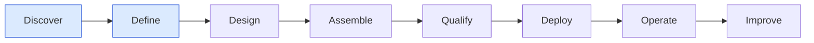

# Build Your First Software Factory

## Goal

Install a control plane, connect one repository under an owned workspace, and write the definition part of a Factory Manifest for a dependency-modernization factory. At the end you have a `Company → Workspace → Repository → Code Scope` chain in Mission Control and a reviewed manifest `FM-depmod` in state `DEFINED`. You have not assembled a Factory Version yet; that is tutorial 07.

This tutorial covers Factory Lifecycle stages 1–2, **Discover** and **Define** ([/framework/factory-lifecycle](/framework/factory-lifecycle)).

## What you will have at the end

| Artifact | Id | Where it lives |
|---|---|---|
| Opportunity record | `OPP-depmod-01` | FDLC-only; a file in your factory repository |
| Factory Manifest (definition part) | `FM-depmod` (`name: dependency-modernization`, `version: 1.0.0`, `state: DEFINED`) | `factories/dependency-modernization/manifest.yaml`; identity mirrored by a Mission Control `factoryDefinitions` row |
| Workspace, repository connection, code scope | Mission Control ids (`<projectId>`, `<repositoryId>`, `<codeScopeId>`) | `projects`, `workspaceRepositories`, `repositoryCodeScopes` tables |
| Production workflow (Work Graph template) | `depmod-upgrade` | `workflows` table, `contractVersion: factory-workflow-contract/v1` |

## Prerequisites

- Node.js 20 or newer, pnpm 9 or newer, Git.
- A Convex development deployment (created on first run; no cloud account is needed beyond Convex).
- One Git repository you own with a test suite. A public or `INTERNAL` repository is simplest; `CONFIDENTIAL` and `RESTRICTED` classifications restrict remote execution later.
- A second person, or a second identity, to act as Policy Owner. A manifest needs two accountable humans.

## Concepts

- The Factory Lifecycle outer loop: [/framework/factory-lifecycle](/framework/factory-lifecycle) (D03).
- What a factory is and is not: [/framework](/framework), [/architecture](/architecture).
- The Factory Manifest, its 24 sections, and its `DRAFT → DEFINED → DESIGNED` lifecycle: [/specification/v1/factory-manifest](/specification/v1/factory-manifest).
- Why a manifest is edited but a Factory Version is never mutated: [/architecture/factory-versioning](/architecture/factory-versioning), [/patterns/immutable-factory-version](/patterns/immutable-factory-version).



## Steps

### 1. Install and start the control plane

FDLC requires a durable control plane before any factory exists (canon: authority flows down from it, evidence flows back). Mission Control implements the control plane in Convex (Available).

```bash
git clone https://github.com/jaydubya818/MissionControl.git
cd MissionControl
corepack enable
pnpm install
pnpm exec convex dev --once     # creates or links the dev deployment, writes CONVEX_URL
```

Copy the generated `CONVEX_URL` into `VITE_CONVEX_URL` in `.env.local` (`README.md`, "First-time setup"), then start Convex and the operator UI:

```bash
pnpm run dev                    # package.json: concurrently "npx convex dev" + UI
```

Open the printed URL (default `http://localhost:5173`). If you want to look around a populated system first, run the deterministic demo in another terminal pair (`pnpm run dev:demo`, then `pnpm run convex:seed:demo:force`) and open `/v2/command-center`. The demo data is fixture data, not proof of anything (`README.md`, "Software Factory demo").

Do not start the orchestration server or set `CODEX_FACTORY_WORKER_ENABLED=true` yet. Nothing in this tutorial executes an agent.

### 2. Discover: record the opportunity and its baseline

**FDLC step; Mission Control status: not implemented as an artifact.** Mission Control holds intent in `missions` and measures outcomes in `factoryOutcomeProjections`, but it has no opportunity record with a baseline. Write one as a file in your factory repository; the Define stage cites it and tutorial 15's audit trail references it.

```yaml
# factories/dependency-modernization/opportunity.yaml (OPP-depmod-01, illustrative)
id: OPP-depmod-01
problem: Third-party SDK upgrades in checkout services take 3-6 engineer-days each and are deferred.
baseline:                       # measured before any factory exists
  upgradesPerQuarter: 4
  medianCycleTimeDays: 9        # illustrative
  medianEngineerHours: 22       # illustrative
  reopenRate: 0.25              # illustrative
stopCondition: Retire the factory if cost per accepted upgrade exceeds the human baseline for two consecutive quarters.
owner: {kind: human, id: "user:priya.n"}
```

The exit criterion of Discover is a measured, owned opportunity with a stop condition. Numbers you do not have stay `unknown`; do not invent a baseline to satisfy the template.

### 3. Create the workspace and connect the repository

FDLC requires portable repository identity under an owned boundary. Mission Control implements `Company → Workspace → Repository → Code Scope` (Available; `docs/architecture/company-workspace-repository-control-plane.md`).

UI: **Settings → Workspaces & Repositories** (`/v2/projects`). Create a workspace, then connect the repository and classify it.

Convex functions, if you prefer the CLI (`convex/projects.ts`):

```bash
npx convex run projects:create '{"name":"Checkout Platform","slug":"checkout","description":"Checkout services","purpose":"Governed delivery for checkout services","owner":"priya.n","status":"ACTIVE","githubRepo":"acme/checkout-api","githubBranch":"main"}'
npx convex run projects:listRepositories '{"projectId":"<projectId>"}'
npx convex run projects:setRepositoryDataClassification '{"repositoryId":"<repositoryId>","dataClassification":"INTERNAL","reason":"Internal service code; no customer data in repository."}'
```

The classification is not cosmetic. It is frozen into every Factory Version and compared against the live repository at readiness, dispatch, claim, and verification admission (`docs/OVERVIEW.md`, "Company, workspace, and repository boundaries"). A later reclassification requires a new Factory Version. An `UNCLASSIFIED` repository blocks `factory/configuration:createVersion` (`convex/factory/configuration.ts`, "Classify the Factory repository before creating an executable version").

### 4. Create a code scope

FDLC requires the Work Order's change budget to derive from governed path allowlists. Mission Control implements code scopes (Available).

```bash
npx convex run projects:createRepositoryCodeScope '{"repositoryId":"<repositoryId>","name":"checkout-api services","slug":"checkout-api-services","description":"Service code; public API, schema, and auth excluded","includePaths":["services/checkout-api/**"],"excludePaths":["services/checkout-api/api/public/**","services/checkout-api/schema/**","services/checkout-api/auth/**"],"requiredReviewers":["priya.n"],"allowedEnvironments":["LOCAL"],"verificationPolicy":"Independent contract and integration tests must pass before publication review.","approvalPolicy":"HUMAN_REVIEW","approvalPolicyDescription":"HIGH-risk factory; human acceptance required."}'
```

`excludePaths` become denied paths in every Work Order compiled from a Plan that binds this scope; denied paths override allowed paths (`convex/lib/missionWorkOrderContract.ts`).

### 5. Register the Work Graph template as a production workflow

FDLC requires a Work Graph template the factory will instantiate per Work Order (manifest section `work_graph`). Mission Control implements versioned workflows with a structured contract (Available). Legacy YAML under `workflows/` uses free-text `expects` markers; a Factory Version requires `contractVersion: factory-workflow-contract/v1` with schema-validated handoffs (`convex/factory/configuration.ts`, readiness check `workflow-contract`).

```bash
npx convex run workflows:registerProduction '{"projectId":"<projectId>","workflowId":"depmod-upgrade","name":"Dependency upgrade","description":"One bounded implementation Attempt, then independent verification, then a human gate.","topology":"LINEAR","maxConcurrency":1,"agents":[{"id":"implementer","persona":"Bounded dependency-upgrade implementer"}],"steps":[{"id":"implement","agent":"implementer","input":"Upgrade only the named dependency inside the approved code scope and return a candidate revision.","expects":"A schema-valid candidate revision and explicit completion status.","retryLimit":0,"timeoutMinutes":45,"kind":"AGENT","isolation":"WORKTREE","failurePolicy":"BLOCK","outputSchema":{"type":"object","properties":{"status":{"type":"string"},"candidateRevision":{"type":"string"}},"required":["status","candidateRevision"],"additionalProperties":false}},{"id":"gate","agent":"implementer","input":"Wait for the recorded human decision.","expects":"APPROVED","retryLimit":0,"timeoutMinutes":5,"dependsOn":["implement"],"kind":"GATE","isolation":"READ_ONLY","failurePolicy":"BLOCK"}],"active":true}'
```

This is the exact shape the repository's own qualification preparation uses (`scripts/prepare-phase4-mcp-qualification.mjs`). The UI equivalent is the "register production workflow" action in the Factory configuration panel (`apps/mission-control-ui/src/workspace/FactoryConfigurationPanel.tsx`).

### 6. Create the Factory definition

FDLC requires one Factory Manifest per factory. Mission Control implements the manifest *identity* as a `factoryDefinitions` row (identity, `purpose`, `status DRAFT|ACTIVE|ARCHIVED`, `activeVersionId`); the declarative sections are spread across other tables, and no single manifest document exists (Partial; [/specification/v1/factory-manifest](/specification/v1/factory-manifest), Mission Control mapping).

```bash
npx convex run factory/configuration:create '{"repositoryId":"<repositoryId>","name":"Dependency Modernization Factory","purpose":"SOFTWARE"}'
```

One definition per repository × purpose is allowed; calling `create` again returns the existing id (`convex/factory/configuration.ts:434-464`). The row starts as `DRAFT` with `latestVersion: 0`.

### 7. Author the Factory Manifest definition sections

**FDLC step; Mission Control status: Partial (no manifest document).** Write the manifest in your factory repository. Fill the Define sections now; tutorials 02–06 fill the Design sections (`skills`, `tools`, `model_routes`, `execution_profiles`, `verification`, `sandbox`, `economics`) before tutorial 07 assembles a version.

```yaml
# factories/dependency-modernization/manifest.yaml — FM-depmod (Define sections)
schemaVersion: "1.0"
type: fdlc://v1/factory-manifest
id: FM-depmod
namespace: https://acme.example/factories/checkout
name: dependency-modernization
version: 1.0.0
displayName: Dependency Modernization Factory
description: >-
  Upgrades third-party libraries and SDKs in registered repositories without changing
  public API, schema, or authorization behavior, and proves it with independent evidence.
purpose: SOFTWARE
specialization: dependency-upgrade
owner:
  factoryOwner: {kind: human, id: "user:priya.n", identitySource: authenticated, displayName: Priya Natarajan}
  policyOwner:  {kind: human, id: "user:sam.reyes", identitySource: authenticated, displayName: Sam Reyes}
  team: platform-engineering
risk_class: HIGH
autonomy_ceiling: L3
capabilities: [repository-research, dependency-upgrade, run-tests, propose-candidate]
inputs:
  - {kind: work-order, description: A released Work Order of kind SOFTWARE_CHANGE requiring dependency-upgrade., artifactType: fdlc://v1/work-order}
  - {kind: repository-snapshot, description: Control-plane snapshot of the repository at the Plan's base SHA.}
outputs:
  - {kind: candidate, description: An unpublished Git candidate bound to the Work Order revision., artifactType: fdlc://v1/candidate}
  - {kind: evidence, description: Producer-side command logs and diff; never verification evidence., artifactType: fdlc://v1/evidence}
work_graph: {workflowId: depmod-upgrade, versionConstraint: "1", roles: [implementer]}
approval_policy:
  - {riskClass: LOW,      execution: AUTO,             verification: AUTO_DETERMINISTIC,      acceptance: POLICY,                 releaseAuthorization: POLICY}
  - {riskClass: MEDIUM,   execution: AUTO,             verification: INDEPENDENT,             acceptance: POLICY_WITHIN_ENVELOPE, releaseAuthorization: POLICY}
  - {riskClass: HIGH,     execution: AUTO,             verification: INDEPENDENT,             acceptance: HUMAN,                  releaseAuthorization: HUMAN}
  - {riskClass: CRITICAL, execution: HUMAN_AUTHORIZED, verification: INDEPENDENT_PLUS_HUMAN,  acceptance: HUMAN,                  releaseAuthorization: HUMAN}
x-opportunity: OPP-depmod-01
x-mission-control:
  projectId: "<projectId>"
  repositoryId: "<repositoryId>"
  factoryDefinitionId: "<factoryDefinitionId>"
state: DRAFT
createdBy: {kind: human, id: "user:priya.n", identitySource: authenticated}
```

Two manifest invariants apply already: `approval_policy` must cover all four risk classes and must not assign `acceptance: POLICY` to HIGH or CRITICAL; `owner` must name two humans.

### 8. Review with the Policy Owner and move to DEFINED

**FDLC step; Mission Control status: not implemented (manifest review is not a Mission Control transition).** The `DRAFT → DEFINED` transition requires both owners' review recorded in `reviewedBy`, plus `risk_class` and `approval_policy` present. Record it in the manifest and in your repository's review system (a pull request approved by both owners is sufficient evidence).

```yaml
state: DEFINED
reviewedBy:
  - {kind: human, id: "user:priya.n", identitySource: authenticated}
  - {kind: human, id: "user:sam.reyes", identitySource: authenticated}
history:
  - {subjectId: FM-depmod, fromState: DRAFT, toState: DEFINED, actor: {kind: human, id: "user:sam.reyes", identitySource: authenticated}, reason: "Outcome contract, HIGH risk class, L3 ceiling, and approval policy reviewed.", idempotencyKey: "FM-depmod:define:1", occurredAt: "2026-09-11T10:00:00Z"}
```

## Verify

| Check | How |
|---|---|
| Control plane runs | The UI loads; `npx convex run projects:list '{}'` returns your workspace |
| Repository is connected and classified | `projects:listRepositories` shows `status: READY` and `dataClassification: INTERNAL` |
| Code scope exists | `projects:listCodeScopes '{"repositoryId":"<repositoryId>"}'` shows `checkout-api-services` with `active: true` |
| Workflow is registered under the production contract | `workflows:list '{"activeOnly":true}'` shows `depmod-upgrade`; the Factory configuration panel lists it as selectable |
| Factory definition exists | `factory/configuration:getDetail '{"factoryDefinitionId":"<id>"}'` returns `{definition, versions, assessments}` with `definition.status: DRAFT`, `definition.purpose: SOFTWARE`, `definition.latestVersion: 0`, and empty `versions` |
| Manifest validates | Validate `manifest.yaml` against `https://fdlc.ai/schemas/v1/factory-manifest.schema.json` ([/specification/schemas](/specification/schemas)). Expect failures only on the MUST sections you have not written yet (`execution_profiles`, `model_routes`, `runtime`, `sandbox`, `network_policy`, `credential_policy`, `verification`, `evidence`, `observability`, `economics`, `qualification`, `release_policy`); tutorials 02–07 supply them |

## Common problems

| Symptom | Cause | Fix |
|---|---|---|
| `Classify the Factory repository before creating an executable version.` | Repository is `UNCLASSIFIED` | Step 3: `projects:setRepositoryDataClassification` |
| `Factory versions require a current workspace-owned production workflow.` | You installed a legacy YAML workflow from `workflows/` (`pnpm run workflows:seed`) instead of registering a production one | Step 5: `workflows:registerProduction`; legacy workflows have a heuristic completion contract and fail the `workflow-contract` readiness check |
| The UI shows "Anonymous demo authority" | You are in the development identity provider | Fine for tutorials 01–08; acceptance in tutorial 09 needs an authenticated operator (`convex/workOrders.ts`, `accept`) |
| You want to mark the factory "running" | There is no such state. A manifest is `DRAFT`, `DEFINED`, `DESIGNED`, or `ARCHIVED`; only a Factory Version is `ACTIVE` | Continue to tutorial 07 |

## Next tutorial

[Add a skill](/tutorials/add-a-skill) — publish the first Capability Manifest the factory will pin.

## Related

- Guide: [/guides/build-your-first-factory](/guides/build-your-first-factory)
- Spec: [/specification/v1/factory-manifest](/specification/v1/factory-manifest) · [/specification/v1/factory-version](/specification/v1/factory-version)
- Framework: [/framework/factory-lifecycle](/framework/factory-lifecycle) stages Discover, Define
- Patterns: [/patterns/immutable-factory-version](/patterns/immutable-factory-version) · Anti-pattern: [/anti-patterns/mutable-production-factory](/anti-patterns/mutable-production-factory)
- Mission Control: `README.md` Quickstart; `docs/architecture/company-workspace-repository-control-plane.md`; capability ledger `docs/product/software-factory-capability-maturity.md`
- Glossary: Factory, Factory Manifest, Factory Owner, Policy Owner, Code Scope
