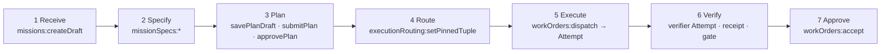

# Execute a Work Order

## Goal

Take one bounded change through Delivery Loop steps 1–7 on the active `FV-depmod-1.0`: record an Intent, approve a Plan that releases a Work Order, route it, dispatch one Attempt under a fenced lease, obtain an unpublished Candidate, have it independently verified, and accept it as a human. At the end `WO-104-01` is `DONE` with an acceptance Decision, and every intermediate state is a distinct record. Nothing in this tutorial merges or deploys anything; Release (step 8) is tutorial 10's neighbor and Mission Control's V1 stops at a review-ready pull request.

The boundaries are the lesson: execution completed ≠ verification passed ≠ current-gate eligible ≠ accepted ≠ merged ≠ production verified (`README.md`).

## What you will have at the end

| Artifact | Id | Mission Control record |
|---|---|---|
| Intent | `INT-104` | `missions` row (`DONE` after Mission acceptance) |
| Specification (optional) | `SPEC-104-r1` | `missionSpecRevisions` (flag `missions.spec-intake-v1`) |
| Plan | `PLAN-104-r2` (approved) | `missionPlans` + Quality Contract projection |
| Work Order | `WO-104-01` (`DONE`) | `workOrders` |
| Routing Decision | `DEC-104-R1` (kind `routing`) | `workOrders.executionRoutingPin` + `modelRoutingDecisions` snapshot frozen on the Attempt |
| Producer Attempt | `ATT-104-01-p1` | `workflowRuns` (`attemptPurpose: IMPLEMENTATION`) with lease and execution manifest |
| Candidate | `CAND-104-01-01` | `workflowRuns.verificationSubject` (commit, tree, contract digest) |
| Verifier Attempt + Verification | `ATT-104-01-v1`, `VER-104-01` | `workflowRuns` (`VERIFICATION`), `verificationRuns`, `verificationReceipts` |
| Acceptance Decision | `DEC-104-03` (kind `acceptance`) | `workOrderEvents` `WORK_ORDER_ACCEPTED` + `qualityGateDecisions` |

## Prerequisites

- Tutorial 08 complete: `FV-depmod-1.0` active for the repository.
- A running orchestration server with the canonical worker enabled and reporting (`pnpm run dev:orchestration`; `CODEX_FACTORY_WORKER_ENABLED=true`, `CODEX_WORKER_PROJECT_ID`, `CODEX_WORKER_REPOSITORY_ID`, `CODEX_WORKER_CHECKOUT_ROOT`, `CODEX_WORKER_HOST_ID`, `CODEX_WORKER_MAX_CONCURRENT_RUNS=1`; `docs/software-factory/worker-runtime-operations.md`). The worker needs the exact Codex CLI the profile froze.
- For step 8 (independent verification): an active factory with `purpose: VERIFICATION` on the same repository. Mission Control schedules the verifier Attempt only when one exists (`convex/factory/attempts.ts`, "no active Verification Factory is configured for this repository"). [Tutorial 12](/tutorials/create-a-second-factory) builds it as `FV-review-1.0`; do its steps first, or stop this tutorial after step 7 with a candidate awaiting verification.
- Two human identities: a Plan author and a separate approver. A plan author cannot approve the same revision (`convex/missions.ts`, `approvePlan`). Acceptance requires an authenticated operator with `factory.approve` and `delivery.approve`; anonymous demo authority is refused.

## Concepts

- The ten-step Delivery Loop (D02): [/framework/delivery-loop](/framework/delivery-loop).
- Work Order state machine (D27) and Attempt/lease state machine (D31): [/specification/v1/work-order](/specification/v1/work-order), [/specification/v1/attempt](/specification/v1/attempt).
- Candidate identity: commit + tree + diff digest + contract digest + source Attempt: [/specification/v1/candidate](/specification/v1/candidate).
- Patterns: [/patterns/lease-based-worker](/patterns/lease-based-worker), [/patterns/evidence-bound-acceptance](/patterns/evidence-bound-acceptance), [/patterns/publication-permit](/patterns/publication-permit), [/patterns/human-authority-gate](/patterns/human-authority-gate).

**Mission Control status: Available (Qualified)** for the whole path Mission → approved Plan → Work Order → Task → Attempt → candidate → independent verification → `workOrders.accept` (ledger rows "Governed intent, Plans, and WorkOrders", "Durable execution and recovery", "Independent verification and Quality Gates"). The browser-operated proof is `docs/testing/evidence/real-codex-github-pr-golden-path/README.md`. Divergences: no `ROUTED` Work Order state (Proposed); routing is frozen on the Attempt; acceptance is human-only (FDLC permits policy acceptance for LOW/MEDIUM within an envelope, Proposed in Mission Control); Decisions are events and fields, not one record type.



## Steps

### 1. Receive: record the Intent

FDLC requires an Intent with goal, constraints, owner, risk, stop condition, and budget; admission makes it an Objective. Mission Control implements the Mission (`convex/missions.ts`, `createDraft`; UI `/v2/missions`).

```bash
npx convex run missions:createDraft '{"projectId":"<projectId>","idempotencyKey":"INT-104","title":"Upgrade acme-payments-sdk to 4.x in checkout-api","objective":"checkout-api runs on acme-payments-sdk 4.x with unchanged public API, schema, and authorization behavior.","context":"Vendor migration guide digest a948f27; sync client only; async migration out of scope.","constraints":["Keep the sync client","Do not alter retry semantics"],"sourceOfTruthRefs":[{"kind":"DOC","label":"Vendor migration guide","location":"https://docs.acme.example/payments-sdk/v4-migration"}],"owner":"priya.n","budgetUsd":25,"stopCondition":"Stop after three Attempts or when the change budget would be exceeded.","repositoryId":"<repositoryId>","codeScopeIds":["<codeScopeId>"],"executionEnvironment":"LOCAL","maxReadOnlyConcurrency":1,"maxCorrectiveIterations":2}'
```

The Mission starts `DRAFT` with `executionPolicy: SERIAL_MUTATIONS` (exactly one mutating Work Order active at a time). A Mission is bound to one repository; multi-repository Missions are Planned (tutorial 14).

### 2. Specify (optional): finalize a Mission Spec

**Mission Control status: Experimental, default off** (project flag `missions.spec-intake-v1`). When enabled, `missionSpecs:saveMissionSpecRevision`, `evaluateMissionSpecRevision` (deterministic quality checks: placeholders, testability, contradictions, coverage), and `finalizeMissionSpecRevision` produce `SPEC-104-r1` with a digest the Plan binds. `FINALIZED` means planning-ready only; it approves nothing (`convex/schema.ts`, `missionSpecRevisions`). Without the flag, the Mission's `objective`, `constraints`, and `sourceOfTruthRefs` are the specification the Plan carries.

### 3. Plan: draft, submit, approve

FDLC requires a Plan (Work Graph, Work Order blueprints, verification strategy, budgets) whose approval binds one exact revision and does not dispatch. Mission Control: `savePlanDraft` (author) → `submitPlan` (author) → `approvePlan` (a different human), which compiles the Quality Contract and releases Work Orders idempotently (`convex/missions.ts`; `docs/software-factory/governed-missions-contract.md`). A governed planning agent can draft the Plan (`missionPlanning:request`; Experimental, its live run was a NO-GO).

```bash
# author identity
npx convex run missions:savePlanDraft '{"projectId":"<projectId>","missionId":"<missionId>","idempotencyKey":"PLAN-104-r1","summary":"Bounded upgrade of acme-payments-sdk 3.x to 4.x inside services/checkout-api; contract and integration suites verify behavior; scope reconciled against protected paths.","rollbackApproach":"Revert the single upgrade commit; lockfile restored from the base SHA.","estimatedCostUsd":25,"assertions":[{"assertionId":"AS-104-01","title":"Behavior preserved","outcome":"CT-* and IT-* suites pass on the exact candidate in a clean verifier worktree with 0 failures and 0 skipped.","verificationMethod":"TEST","passCondition":"Independent verifier Attempt records TEST_RESULT PASS.","requiredEvidence":"Candidate SHA, tree SHA, Verification Subject, frozen Verification Plan, verifier Attempt, receipt.","requiresIndependentValidation":true,"waiverAllowed":false},{"assertionId":"AS-104-02","title":"No v3 artifacts, no new dependencies","outcome":"Dependency scan finds no acme-payments-sdk@3 and no added dependency.","verificationMethod":"COMMAND","passCondition":"acme-depscan exits 0.","requiredEvidence":"Scan output bound to the candidate.","requiresIndependentValidation":true,"waiverAllowed":false}],"workOrderBlueprints":[{"id":"BP-104-01","title":"Implement bounded SDK v4 upgrade","desiredOutcome":"checkout-api on acme-payments-sdk 4.x with unchanged public API, schema, and authorization behavior.","workflowId":"depmod-upgrade","sequence":1,"role":"WORKER","isMutating":true,"priority":2,"riskLevel":"MEDIUM","branchStrategy":"feature/payments-sdk-v4","constraints":["Keep the sync client","Do not alter retry semantics"],"requiredApprovals":[],"estimatedCostUsd":25,"implementationPolicy":{"allowedCommands":["pnpm install","pnpm test --filter checkout-api"],"independentVerification":{"executable":"pnpm","args":["test","--filter","checkout-api","--","--grep","CT-|IT-"],"category":"INTEGRATION_TEST","commandClass":"TEST","evidenceCategory":"TEST_RESULT","timeoutMs":1200000},"maxFilesChanged":40,"maxLinesChanged":1200,"maxCostUsd":25,"maxAttempts":3,"timeoutMinutes":90,"stopCondition":"Stop after three Attempts or when the change budget would be exceeded."},"dependsOnBlueprintIds":[],"assertionIds":["AS-104-01","AS-104-02"]}]}'
npx convex run missions:submitPlan '{"projectId":"<projectId>","missionId":"<missionId>","planId":"<planId>","idempotencyKey":"PLAN-104-r1:submit"}'
# approver identity (must differ from the author)
npx convex run missions:approvePlan '{"projectId":"<projectId>","missionId":"<missionId>","planId":"<planId>","decisionReason":"Scope, verification, rollback, and budget reviewed against FM-depmod.","idempotencyKey":"PLAN-104-r1:approve"}'
```

`approvePlan` revalidates the repository binding and workflow versions, refuses author = approver, compiles the Quality Contract, and returns `{mission, plan, workOrders}`. The released `WO-104-01` carries a v2 `ENFORCED` verification contract compiled from `implementationPolicy` (tutorial 06 step 5), a change budget from the code scope, three default negative constraints, `autonomyLevel: LEVEL_2`, and `requiredApprovals: []`, because Plan approval was the human gate that released it. This is Decision `DEC-104-01` (kind `plan-approval`). It dispatches nothing.

```bash
npx convex run missions:start '{"missionId":"<missionId>","idempotencyKey":"INT-104:start"}'
```

### 4. Route: bind the Factory Version

FDLC requires a routing Decision that binds the Work Order to an active Factory Version and Execution Profile before dispatch, eligibility filtered before ranking. Mission Control routes at dispatch: with an `ADVISORY` policy the current active version for the repository is used; a human may pin an exact version (`executionRouting:setPinnedTuple`, permission `factory.approve` + `delivery.approve`), and the preview is read-only (`executionRouting:previewForWorkOrder`). The decision snapshot and its SHA-256 digest are frozen onto the Attempt before any claim (`docs/architecture/execution-routing-v1.md`, "Frozen decision record").

```bash
npx convex run executionRouting:previewForWorkOrder '{"workOrderId":"<workOrderId>"}'
npx convex run executionRouting:setPinnedTuple '{"workOrderId":"<workOrderId>","factoryDefinitionVersionId":"<factoryDefinitionVersionId>","reason":"Tutorial: pin WO-104-01 to FV-depmod-1.0 (DEC-104-R1)."}'
```

Only an active exact version in the same repository and workflow can be pinned; pinning is ranking authority only, and eligibility is re-evaluated at dispatch and claim. Write `DEC-104-R1` (kind `routing`, `mode: PINNED`, `level: 2`) in your decisions directory; the `ROUTED` state on the Work Order is FDLC-only.

### 5. Execute: dispatch one Attempt

FDLC requires an Attempt admitted under a fenced lease with a frozen execution manifest. Mission Control's `workOrders:dispatch` runs preflight (repository, scope, Factory Version readiness, executor capability, host, policy, budget), enforces one active mutating Attempt per repository, freezes `factory-execution-manifest/v3` with the exact profile and qualification identity, and creates the `workflowRuns` row (`convex/workOrders.ts`, `dispatch`; `convex/lib/workOrderDispatch.ts`). The canonical Task binding is optional but is what the golden path used:

```bash
npx convex run tasks:create '{"projectId":"<projectId>","workOrderId":"<workOrderId>","title":"Implement bounded SDK v4 upgrade","type":"ENGINEERING","priority":2,"idempotencyKey":"TASK-104-01-1","source":"DASHBOARD","createdBy":"HUMAN"}'
./scripts/mc dispatch <workOrderId> depmod-upgrade          # workOrders:dispatch with actorType HUMAN and a fresh idempotency key
```

The result is `{created, run}`; `run.status` starts `PENDING`. The worker then claims it: `attempts.claim` checks registration, heartbeat, repository access, executor, isolation, required harness capabilities, exact manifest and config digests, provider and model, sandbox capabilities, backend, profile qualification, Factory Version binding, and server-counted leases, and writes a lease `{leaseId, workerId, workerSessionId, workerGeneration, expiresAt}` (`docs/software-factory/worker-runtime-operations.md`, "Claim and heartbeat behavior"). The harness runs `prepare → execute → collectResult → cleanup` inside an allowlisted process group; it receives no service, GitHub, or provider-management credentials.

```bash
./scripts/mc run-summary <runId>          # workflowRuns:get + getInspector
./scripts/mc run-events <workflowRunDocId>
```

Completion yields `run.status: COMPLETED`, `candidateReadyAt`, and `verificationSubject` (kind `GIT_CANDIDATE`, `candidateSha`, `treeSha`, `verificationContractDigest`, `sourceAttemptId`, `digest`). That subject is `CAND-104-01-01`. It is unpublished and unverified; a `COMPLETED` status is not evidence (`docs/architecture/generic-harness-contract-v1.md`, "harness `COMPLETED` status never counts as verification evidence").

### 6. Recover if the Attempt fails

Retries create new Attempts and never rewrite history. Dispatch again with `retryOfWorkflowRunId` and `retryReason` (the synthetic qualification does exactly this, `scripts/qualification/run-local-synthetic-mission.mts`); cancellation is `workflowRuns:requestCancellation`. A lease that expires without a publication checkpoint becomes `LOST`, the workspace is preserved, and cleanup fails closed to `PRESERVED` on any ambiguity. The golden path's PR #62 chain (cancel → two failures → fourth Attempt success, no duplicate PR) is the reference.

### 7. Publish (permit-gated) or keep the candidate local

FDLC requires publication to use a short-lived, candidate-bound, lease-bound permit issued immediately before the provider mutation. Mission Control's worker requests a single-use permit (`authorizePublicationInternal`, `convex/factory/attempts.ts`) that checks active lease match, repository publication allowed, revision match, a current `PREPUBLICATION` evaluation for `ENFORCED` v2 contracts, and approvals; only the GitHub App publisher (`apps/orchestration-server/src/githubAppPublisher.ts`) holds publication authority, with a just-in-time installation token never stored. Without a GitHub App the candidate stays a `LOCAL_GIT` subject: it can be independently verified, but acceptance-currentness stays false without a trusted publication projection (`docs/software-factory/worker-runtime-operations.md`, Phase 4 paragraph).

### 8. Verify: the independent verifier Attempt

FDLC requires a separate Verification Attempt against a frozen Verification Subject and Plan, independence proven by lineage and by standard, and currentness computed on the newest candidate and newest exact-bound verification. Mission Control creates the Verification Subject, freezes the Verification Plan, schedules a verifier Attempt on the active `VERIFICATION` factory (`convex/factory/attempts.ts:3172+`), records `verificationRuns`, `evidenceEnvelopes`, and a `WORK_ORDER`-scope receipt with verdict `VERIFIED | NOT_VERIFIED | BLOCKED | REQUIRES_HUMAN_REVIEW`, and appends a Quality Gate Decision (`ELIGIBLE`, `INELIGIBLE`, `UNKNOWN`, `STALE`, `WAIVER_REQUIRED`, `AWAITING_HUMAN`).

Independence is enumerated: separate Attempt, lease, worktree, invocation (lineage), and no verdict-determining file modified by the candidate (standard) (`packages/workflow-engine/src/verificationIndependence.ts`). The human alternative, `workOrders:recordVerificationReceipt` (`delivery.verify`), records a receipt but is not independent and does not satisfy an `ENFORCED` v2 contract.

```bash
node packages/cli/dist/index.js work-order inspect <workOrderId>     # verdict, per-check status, evidence counts, violations
npx convex run workOrders:get '{"workOrderId":"<workOrderId>"}'        # currentVerification.eligible, qualityGateDecisions, verificationRuns
```

### 9. Approve: accept as a human

FDLC requires exactly one acceptance boundary: a server-authorized Decision that recomputes currentness at decision time and requires zero active Attempts. Mission Control: `workOrders:accept` is "the canonical WorkOrder acceptance boundary and the only implementation that writes the `WORK_ORDER_ACCEPTED` transition" (`docs/OVERVIEW.md`). It rejects non-`HUMAN` actors, active runs, and demo identities; for `ENFORCED` v2 contracts it recomputes exact-current verification, appends the gate decision, and writes either `WORK_ORDER_ACCEPTANCE_REJECTED` or `WORK_ORDER_ACCEPTED` (`convex/workOrders.ts:5279-5589`). UI: `/v2/control-work-orders`, Accept.

```bash
./scripts/mc accept <workOrderId>                # workOrders:accept, actorType HUMAN
npx convex run missions:accept '{"missionId":"<missionId>","acceptedBy":"user:priya.n","idempotencyKey":"INT-104:accept"}'
```

This is `DEC-104-03` (kind `acceptance`) with `current: true`, `activeAttempts: 0`, the Candidate and Verification ids as inputs. Accepting the Work Order does not merge the pull request; accepting the Mission does not deploy. Merge remains a human decision in GitHub.

## Verify

| Check | How |
|---|---|
| Each state is distinct and ordered | `workOrders:get` events in order: `WORK_ORDER_CREATED` (released by Plan approval; the Mission event is `PLAN_APPROVED`) → `DISPATCH_REQUESTED` → `DISPATCHED` → `RUN_COMPLETED` → `CANDIDATE_READY` → `VERIFICATION_ATTEMPT_DISPATCHED` → `VERIFICATION_RECORDED` → `WORK_ORDER_ACCEPTANCE_ELIGIBLE` → `WORK_ORDER_ACCEPTED` (`convex/schema.ts`, `workOrderEvents.eventType`); `workOrder.state: DONE`, `verificationStatus: PASS`, `approvalStatus: APPROVED` |
| The Attempt is frozen and fenced | `run.executionManifest` is `factory-execution-manifest/v3` with the profile digest and qualification digest; `run.lease` has worker, session, generation, expiry; `run.executionRoutingSnapshot` and `routingDecisionDigest` present |
| Candidate identity is exact | `verificationSubject.candidateSha`, `treeSha`, `verificationContractDigest`, `sourceAttemptId`, `digest` all set |
| Verification is independent and current | `verificationRuns[0].verdict: VERIFIED`; receipt `status: PASSED`, unexpired; `currentVerification.eligible: true`; latest `qualityGateDecisions[0].state: ELIGIBLE`; independence result passed with no reasons |
| Acceptance was the only completion path | The only `WORK_ORDER_ACCEPTED` event has `actorType: HUMAN`; the test `convex/__tests__/governedHardeningAuthority.test.ts` asserts no other writer exists |
| A moved head invalidates | Push another commit to the branch, re-run `workOrders:get`: `currentVerification.eligible` becomes false with a head-mismatch reason ([/patterns/candidate-currentness](/patterns/candidate-currentness)) |

## Common problems

| Symptom | Cause | Fix |
|---|---|---|
| `A plan author cannot approve the same plan revision` | Same authenticated identity | Use the approver identity |
| `Mutating Mission WorkOrders require a fully specified independent verification and change budget policy` | Blueprint missing `independentVerification`, `maxFilesChanged`, or `maxLinesChanged` | Fill `implementationPolicy` |
| Dispatch fails preflight with a Factory readiness reason | Readiness expired or `BLOCKED` | Tutorial 08 step 1 |
| Attempt stays `PENDING` | No eligible worker claims it (digest, capability, backend, capacity, or heartbeat mismatch) | Check worker registration and the claim-rejection reason (`worker-runtime-operations.md`, "Monitoring") |
| `Candidate is ready, but no active Verification Factory is configured for this repository.` | No `purpose: VERIFICATION` factory active | Tutorial 12 |
| `WorkOrder cannot be accepted while an execution run is active` | An Attempt is still running | Wait, cancel, or let the lease reconcile |
| `WorkOrder acceptance is reserved for an authenticated human operator.` / demo authority refused | CLI actor or demo mode | Accept as an authenticated operator with `delivery.approve` |
| Accepted but the PR is not merged | Correct; merge is outside the acceptance boundary | Merge in GitHub as a human; tutorial 10 shows how the release records merge and deployment |

## Next tutorial

[Capture evidence](/tutorials/capture-evidence) — read the envelopes, receipts, and gate decisions this run produced and export them as bound Evidence.

## Related

- Framework: [/framework/delivery-loop](/framework/delivery-loop) (D02, D32)
- Spec: [/specification/v1/intent](/specification/v1/intent) · [/specification/v1/plan](/specification/v1/plan) · [/specification/v1/work-order](/specification/v1/work-order) (D27) · [/specification/v1/attempt](/specification/v1/attempt) (D31) · [/specification/v1/candidate](/specification/v1/candidate) · [/specification/v1/verification](/specification/v1/verification) · [/specification/v1/decision](/specification/v1/decision)
- Patterns: [/patterns/lease-based-worker](/patterns/lease-based-worker) · [/patterns/recovery-checkpoint](/patterns/recovery-checkpoint) · [/patterns/publication-permit](/patterns/publication-permit) · [/patterns/evidence-bound-acceptance](/patterns/evidence-bound-acceptance) · [/patterns/human-authority-gate](/patterns/human-authority-gate) · Anti-patterns: [/anti-patterns/infinite-retry-loop](/anti-patterns/infinite-retry-loop), [/anti-patterns/no-candidate-identity](/anti-patterns/no-candidate-identity)
- Mission Control: `docs/software-factory/governed-missions-contract.md`; `docs/testing/evidence/real-codex-github-pr-golden-path/README.md`; `scripts/mc` (`dispatch`, `accept`, `run-summary`, `run-events`)
- Glossary: Intent, Objective, Plan, Work Order, Attempt, Lease, Candidate, Verification Subject, Acceptance
