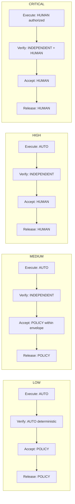

# Configure Approval Policy

## Goal

Write down, per risk tier, which actor may authorize execution, which verification is required, who accepts, and who authorizes release; express that as the manifest's `approval_policy` and as Mission Control's governance, change-risk, and policy-envelope records; then watch the policy produce and constrain real Decisions on `WO-104-01`. At the end you have `POL-approval-risk-tiers` v1 pinned by digest in `FV-depmod-1.0`'s composition, and you can name the Decision kind behind every gate the run passed.

Capability ≠ permission ≠ authority. A policy engine may authorize within delegated bounds; it never widens them. Humans approve consequential decisions and keep override and restoration authority ([/architecture/authority](/architecture/authority), D16).

## What you will have at the end

| Artifact | Id | Where |
|---|---|---|
| Approval policy | `POL-approval-risk-tiers` v1 (`approval_policy[]` in `FM-depmod`; `PolicyDigest` in `FV-depmod-1.0.composition.approvalPolicy`) | `factories/dependency-modernization/policies/approval-risk-tiers.yaml` |
| Governance policy | verification-first v1 (validity windows, re-approval and re-verification rules) | Mission Control `governancePolicies` |
| Change-risk policy | v1 (`requireHuman` per path pattern) | `changeRiskPolicies` |
| Policy envelope | `POL-bundle-checkout` v1 (autonomy tier, tool policies, approval-on-risk) | `policyEnvelopes` (tutorial 07) |
| Role and permission mapping | Factory Owner, Policy Owner, Verification Engineer, Work Order owner → Mission Control permissions | `companyMembers`, `roleAssignments` |
| Decisions observed | `DEC-104-01` plan-approval · `DEC-104-R1` routing · `DEC-104-02` admission · `DEC-104-03` acceptance | `missionPlans` fields, `executionRoutingPin`, claim checks, `workOrderEvents` + `qualityGateDecisions` |

## Prerequisites

- Tutorials 07–10 complete; a `DONE` Work Order to read decisions from.
- An operator with `workspaces.manage` (governance policy), `factory.approve` (change-risk policy, approvals), and `members.manage` (roles).

## Concepts

- Actors and what each may do; risk-tiered autonomy; the HITL spectrum (D17): [/architecture/authority](/architecture/authority).
- Decision, eight kinds, permitted actors per kind, server authorization, separation of duty: [/specification/v1/decision](/specification/v1/decision), [/patterns/decision-record](/patterns/decision-record).
- Progressive autonomy and its failure modes: [/patterns/progressive-autonomy](/patterns/progressive-autonomy), [/anti-patterns/human-approval-everywhere](/anti-patterns/human-approval-everywhere), [/anti-patterns/agent-as-authorization-system](/anti-patterns/agent-as-authorization-system).

**Mission Control status: Available** for server-authorized human decisions, per-risk approval validity, change-risk human gates, human-review continuation with permits, waivers, and the human-only acceptance boundary. Divergences: Mission Control has five approval stores (Plan fields, `approvalDecisions`, legacy `approvals`, ARM `approvalRecords`, intent contribution decisions) where FDLC keeps one Decision type (audit §7); promotion and activation record an activity, not a Decision; policy acceptance for LOW/MEDIUM risk inside a delegated envelope is permitted by the specification and Proposed in Mission Control, whose `workOrders.accept` accepts only `HUMAN` actors (canon §18.10). Server enforcement of the Mission and Work Order human-vs-service split is inventoried and partly pending (`docs/security/human-service-authorization-matrix.md`).



## Steps

### 1. Write the risk-tier policy

**FDLC step; Mission Control status: Partial (the tiers are enforced across several records, not declared once).** The manifest section from tutorial 01, now as a standalone, digested policy:

```yaml
# factories/dependency-modernization/policies/approval-risk-tiers.yaml — POL-approval-risk-tiers v1
policyId: POL-approval-risk-tiers
version: "1"
tiers:
  - {riskClass: LOW,      execution: AUTO,             verification: AUTO_DETERMINISTIC,     acceptance: POLICY,                 releaseAuthorization: POLICY}
  - {riskClass: MEDIUM,   execution: AUTO,             verification: INDEPENDENT,            acceptance: POLICY_WITHIN_ENVELOPE, releaseAuthorization: POLICY}
  - {riskClass: HIGH,     execution: AUTO,             verification: INDEPENDENT,            acceptance: HUMAN,                  releaseAuthorization: HUMAN}
  - {riskClass: CRITICAL, execution: HUMAN_AUTHORIZED, verification: INDEPENDENT_PLUS_HUMAN, acceptance: HUMAN,                  releaseAuthorization: HUMAN}
envelope:                                   # bounds inside which POLICY may accept MEDIUM work
  maxFilesChanged: 40
  maxLinesChanged: 1200
  allowedCommandClasses: [BUILD, TYPECHECK, TEST, LINT, DEPENDENCY_SCAN]
  noProtectedPathTouched: true
  noWaivedMandatoryCheck: true
  noDiscoveredRisk: true
validity:
  approvalHoursByRisk: {LOW: 336, MEDIUM: 168, HIGH: 72, CRITICAL: 24}
  verificationHours: 168
  reapprovalAfterMaterialChange: true
  reverificationAfterCodeChange: true
effectiveAutonomy: min(factory, objective, workOrder, policy, trust)
demotion: immediate on evidence regression
```

Invariants: all four tiers present; `acceptance: POLICY` never on HIGH or CRITICAL; CRITICAL execution is human-authorized before it starts. Under Mission Control today the `MEDIUM` row's `POLICY_WITHIN_ENVELOPE` acceptance still resolves to a human at `workOrders.accept`; declare it anyway so the envelope is reviewed and the divergence is explicit.

### 2. Map tiers to Mission Control's risk vocabulary

Mission Control classifies risk on the server as a minimum (`docs/software-factory/verification-first-workorder-contract.md`, "Risk is a server-owned minimum classification"): Work Orders carry `riskLevel LOW|MEDIUM|HIGH|CRITICAL`; Factory Versions carry `riskBoundary GREEN|YELLOW|RED`; tool calls are classified `GREEN|YELLOW|RED` (`convex/lib/riskClassifier.ts`, "RED always requires approval"). `RED` Work Orders are never auto-routed (`docs/architecture/execution-routing-v1.md`). Record the mapping in the policy's `x-mission-control` block: LOW → GREEN, MEDIUM → YELLOW, HIGH and CRITICAL → RED.

### 3. Activate validity windows

The `validity` block is Mission Control's governance policy (tutorial 06 step 7). If you skipped it:

```bash
npx convex run governancePolicies:activateVerificationFirstV1 '{"projectId":"<projectId>"}'
```

Approvals expire by risk (LOW 14 days, MEDIUM 7, HIGH 3, CRITICAL 1) and verification after 7 days; material revisions require re-approval; code, workflow, or environment changes require re-verification; a change to an accepted Work Order reopens it fully (`convex/governancePolicies.ts`). `./scripts/mc expired-approvals <workOrderId>` and `./scripts/mc governance <workOrderId>` read the effect.

### 4. Declare human gates by path

FDLC's `requiredDecisions` and `escalationConditions` on the Work Order's authority envelope name where a human must decide. Mission Control's change-risk policy makes `requireHuman` a function of path patterns and strictness (`convex/context/changeRisk.ts`):

```bash
npx convex run context/changeRisk:upsertPolicy '{"projectId":"<projectId>","name":"depmod change risk v2","strictness":70,"rules":[{"id":"auth","label":"Authorization code requires a human","requireHuman":true,"globPatterns":["services/checkout-api/auth/**"]},{"id":"schema","label":"Schema changes require a human","requireHuman":true,"globPatterns":["services/checkout-api/schema/**"]},{"id":"deps","label":"Dependency manifest changes require a human","requireHuman":true,"globPatterns":["**/package.json","**/pnpm-lock.yaml"]}]}'
```

Code scopes add `requiredReviewers` and `approvalPolicy` per scope (tutorial 01 step 4); dispatch unions reviewer, approval, and verification requirements across every selected scope (`docs/architecture/company-workspace-repository-control-plane.md`).

### 5. Bound the agent's envelope

The policy envelope from tutorial 07 (`governance/policyEnvelopes:createPolicyEnvelope`) carries `autonomyTier`, `requireApprovalOnRisk`, `toolPolicies` (`DENY` / `NEEDS_APPROVAL`), and `executionEnvironments`. It is the Mission Control home of the FDLC `authorityEnvelope` pieces that are not path-based: which actions are allowed, which are denied, and above which risk a human decides. Keep `delete_file: DENY`; keep publication outside every envelope (`publicationAuthority: CONTROL_PLANE_ONLY` is a schema constant on the Work Order).

### 6. Assign roles to permissions

FDLC names Factory Owner, Policy Owner, Verification Engineer, and Work Order owner. Mission Control's permissions (`convex/lib/companyAccess.ts`):

| FDLC role | Decides | Mission Control permission |
|---|---|---|
| Work Order owner / Builder | Intent, Plan authoring, revisions | `delivery.write`, `delivery.assign` |
| Plan approver (≠ author) | `plan-approval` | `delivery.approve` |
| Factory Owner | version creation, dispatch, pins | `factory.automation.manage`, `delivery.dispatch`, `factory.approve` |
| Policy Owner / assessor | route and profile qualification, activation, waivers, revocations | `factory.approve`, `workspaces.manage` |
| Verification Engineer | receipts, verifier definitions | `delivery.verify`, `factory.improve` |
| Incident commander | containment and restoration | `factory.incident.control` |
| Acceptance authority | `acceptance` | `factory.approve` + `delivery.approve`, authenticated human |

Assign with `companyMembers:setRoles` or `governance/roleAssignments:assignRole` (scopes `tenant | project | team | repository | environment`). Browser role labels never determine authority; the server resolves membership and permission on every call.

### 7. Read the Decisions the run produced

Map each gate `WO-104-01` passed to its Decision kind and its Mission Control record:

| Kind | Where it happened | Mission Control record | Actor rule enforced |
|---|---|---|---|
| `plan-approval` (`DEC-104-01`) | `missions:approvePlan` | `missionPlans.approvedBy`, `decisionReason`; `PLAN_APPROVED` event | author ≠ approver; approval dispatches nothing |
| `routing` (`DEC-104-R1`) | `executionRouting:setPinnedTuple` / dispatch | `workOrders.executionRoutingPin`; `modelRoutingDecisions` + snapshot on the Attempt | eligibility before ranking; RED never auto |
| `admission` (`DEC-104-02`) | `attempts.claim` | lease on `workflowRuns`; claim rejection reasons | unknown or stale authority fails closed |
| `acceptance` (`DEC-104-03`) | `workOrders:accept` | `WORK_ORDER_ACCEPTED` event + `qualityGateDecisions` row | human only; currentness recomputed; zero active Attempts |
| `exception` | waiver on a receipt | `verificationReceipts.waiverApprovalDecisionId`; gate `WAIVER_REQUIRED`; `EMERGENCY_BYPASS` mode | never on a hard gate; `WAIVED` stays visible |
| `release-authorization` | `factory/releases:approveStagingDeployment`, `approveProductionDeployment` | `factoryReleases.deploymentApproval*` | human; separate from merge |
| `promotion` | `factory/configuration:activate` | `activities` `FACTORY_VERSION_ACTIVATED` | readiness required; Decision record is FDLC-only |
| `restoration` | `factory/incidentControls:authorizeRepositoryDispatchRestoration` | `factoryIncidentControlAuthorizations` | human, incident-scoped, expiring |

Risk approvals on a Work Order are explicit records: `workOrders:requestApprovalDecision` (`approvalType`, `requestedAction`, `riskLevel`, `expiresAt`) then `decideApprovalDecision` (`APPROVE | APPROVE_WITH_CONDITIONS | REJECT | REQUEST_REVISION`, `reason`, `conditions`); `workOrders:approvalQueue` lists what is pending. Conditions are re-checked by the next gate as data.

### 8. Exercise the human-review gate

Set `requireHumanReview: true` on a Work Order's verification contract (or let the change-risk policy trigger it) and dispatch. The verdict becomes `REQUIRES_HUMAN_REVIEW`; the Attempt pauses; a human records the approval; a single-use publication permit bounded by lease, approval, and receipt is issued on resume (`docs/software-factory/verification-and-gate-state-machines.md`, "Human review continuation"; evidence `docs/testing/evidence/pr-72-human-review-resume`). This is the `AWAITING_APPROVAL → IN_PROGRESS` transition on D27 and the shape of every consequential human gate: paused Attempt, recorded Decision, bounded permit, same Attempt resumes.

## Verify

| Check | How |
|---|---|
| Policy covers four tiers and never lets policy accept HIGH/CRITICAL | Validate `approval-risk-tiers.yaml` against the `RiskTierPolicy` definition in the Factory Manifest schema |
| Separation of duty holds | Attempt `approvePlan` as the author: refused |
| Acceptance is human and server-authorized | `./scripts/mc accept` with the demo identity is refused; an authenticated approver succeeds; the event carries `actorType: HUMAN` and the server-derived actor id, not a client label |
| Validity windows apply | `mc governance <workOrderId>` shows approval and verification expiry consistent with the risk level |
| Human gate by path fires | A candidate touching `services/checkout-api/auth/**` yields `REQUIRES_HUMAN_REVIEW` or `BLOCKED`, never `VERIFIED` alone |
| Waivers stay visible | A waived check shows `WAIVED` in `mc work-order inspect`, never `PASS`; the gate reads `WAIVER_REQUIRED` until the exception Decision exists |
| No advisory system decided anything | Memory, traces, evals, and learning records carry `acceptanceAuthority: false`; none appears as an actor in any decision record |

## Common problems

| Symptom | Cause | Fix |
|---|---|---|
| Every Work Order needs three human approvals | Approval-on-risk set for GREEN, scope approval policy `HUMAN_REVIEW` everywhere, plus `requireHumanReview` | One governed gate per consequence; Plan approval already released the Work Order ([/anti-patterns/human-approval-everywhere](/anti-patterns/human-approval-everywhere)) |
| Policy says MEDIUM may be accepted by policy, but acceptance waits for a human | Mission Control acceptance is human-only | Expected; record the divergence, keep the envelope declared |
| An approval "expired" overnight | HIGH validity is 72 hours | Re-request; expiry is by risk, not by calendar convenience |
| A revision silently kept old approvals | It cannot; material revisions invalidate approvals and receipts per policy | Read `revisions[].materiality` and `impactedApprovals` |
| An agent "approved" its own work in a chat transcript | Transcripts are not decisions | Only server-authorized records count; `workOrders.accept` rejects `AGENT` |

## Next tutorial

[Create a second factory](/tutorials/create-a-second-factory) — the code-review factory that makes `SEPARATE_FACTORY` independence real.

## Related

- Spec: [/specification/v1/decision](/specification/v1/decision) · [/specification/v1/work-order](/specification/v1/work-order) (`authorityEnvelope`) · [/specification/v1/factory-manifest](/specification/v1/factory-manifest) (`approval_policy`)
- Architecture: [/architecture/authority](/architecture/authority) (D16, D17) · [/enterprise/policy-governance](/enterprise/policy-governance)
- Patterns: [/patterns/human-authority-gate](/patterns/human-authority-gate) · [/patterns/decision-record](/patterns/decision-record) · [/patterns/progressive-autonomy](/patterns/progressive-autonomy) · Anti-patterns: [/anti-patterns/human-approval-everywhere](/anti-patterns/human-approval-everywhere), [/anti-patterns/agent-as-authorization-system](/anti-patterns/agent-as-authorization-system), [/anti-patterns/prompt-as-governance](/anti-patterns/prompt-as-governance)
- Mission Control: `docs/security/human-service-authorization-matrix.md`; `docs/software-factory/verification-and-gate-state-machines.md`; `convex/lib/companyAccess.ts`
- Glossary: Decision, Risk tier, Authority envelope, HITL spectrum, Waiver, Separation of duty
