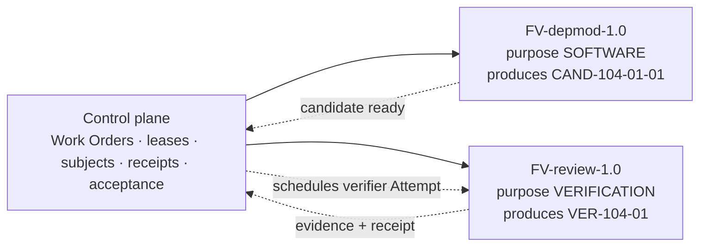

# Create a Second Factory

## Goal

Build a second, specialized factory on the same repository: a code-review factory whose purpose is `VERIFICATION`. It never mutates a candidate; it evaluates one against a frozen Verification Plan, runs the mandatory checks in a read-only worktree, records review findings as evidence, and returns a verdict. Activating it turns the `SEPARATE_FACTORY` independence boundary declared in tutorial 06 from a manifest statement into an enforced runtime fact, and it is the factory tutorial 09 needed before its verify step.

Organizations operate many specialized factories, not one universal factory. Create a separate factory only when outcome semantics, ownership, qualification, governance, authority, or lifecycle materially differ ([/framework](/framework), catalog). A verifier's authority differs from a producer's by construction: it attests and never proposes or publishes.

## What you will have at the end

| Artifact | Id | Where |
|---|---|---|
| Factory Manifest | `FM-review` (`name: code-review`, `purpose: VERIFICATION`, `specialization: code-review`) | `factories/code-review/manifest.yaml` |
| Execution Profile | `EP-review-1.0-prod` (`isolationModes: [READ_ONLY]`, workload `VERIFICATION`) | `factoryExecutionProfiles` |
| Factory Version | `FV-review-1.0` (`state: ACTIVE`) | `factoryDefinitionVersions`; `factoryDefinitions` (`purpose: VERIFICATION`) with `activeVersionId` |
| Qualification Record | `QR-review-1.0-01` | `factories/code-review/qualification/` |
| Updated producer manifest | `FM-depmod.verification.independence.verifierFactoryName: code-review` | `manifest.yaml` (new manifest version, no change to `FV-depmod-1.0`) |

## Prerequisites

- Tutorials 07–08 complete for `FV-depmod-1.0` (the same repository, workspace, code scope, policy envelope, and verifiers are reused).
- A route qualified for the `VERIFICATION` workload class (step 2); ideally a different provider or model family from the producer's.
- A registered worker able to run read-only verification Attempts on the same host or a second host.

## Concepts

- Local factory vs ecosystem, and why factories do not orchestrate one another (D20, D09): [/architecture/multi-factory](/architecture/multi-factory), [/patterns/multi-factory-orchestration](/patterns/multi-factory-orchestration).
- Verification hierarchy and independence by factory boundary (D15): [/architecture/verification](/architecture/verification), [/patterns/independent-verifier](/patterns/independent-verifier).
- The specialized-factory catalog (Code Review is one of fourteen): [/framework](/framework); the build guide: [/guides/code-review-factory](/guides/code-review-factory).

**Mission Control status: Available** for a second Factory definition on the same repository with `purpose: VERIFICATION`, selected automatically when a producer Attempt's candidate becomes ready (`convex/factory/attempts.ts`, `definitions.find(candidate.status === "ACTIVE" && candidate.purpose === "VERIFICATION" && candidate.activeVersionId)`). The verifier's isolation is forced to `READ_ONLY` (`factoryIsolationMode`) and its workload class to `VERIFICATION`. Divergences: a factory registry across workspaces with declared capabilities is Planned (audit §5.2); Mission Control finds the verifier by repository and purpose only, one active verification factory per repository; independence is recorded as `SEPARATE_ATTEMPT` even when the verifier is a separate factory.



Factories never call each other. The control plane freezes the subject and schedules the verifier; the verifier never receives publication or acceptance authority.

## Steps

### 1. Define FM-review

**FDLC step; Mission Control status: Partial (manifest identity only).** The Define sections that differ from `FM-depmod`:

```yaml
# factories/code-review/manifest.yaml — FM-review (Define excerpt)
id: FM-review
name: code-review
version: 1.0.0
displayName: Code Review Factory
description: Independently evaluates an exact candidate against its frozen Verification Plan; records review findings and check results as evidence; never mutates, publishes, or accepts.
purpose: VERIFICATION
specialization: code-review
owner:
  factoryOwner: {kind: human, id: "user:lena.k", identitySource: authenticated}     # not the producer's owner
  policyOwner:  {kind: human, id: "user:sam.reyes", identitySource: authenticated}
risk_class: MEDIUM
autonomy_ceiling: L3
capabilities: [code-review, run-verification-plan, independent-test-execution, static-analysis]
inputs:
  - {kind: candidate, description: A frozen Verification Subject (commit, tree, contract digest, source Attempt)., artifactType: fdlc://v1/candidate}
  - {kind: verification-plan, description: The frozen plan compiled from the Work Order's verification contract.}
outputs:
  - {kind: verification, description: Verifier Attempt result with per-check status and receipt., artifactType: fdlc://v1/verification}
  - {kind: evidence, description: TEST_RESULT, STATIC_ANALYSIS, DEPENDENCY_SCAN, FILE_DIFF, REVIEW_RESULT envelopes bound to the subject., artifactType: fdlc://v1/evidence}
work_graph: {workflowId: code-review-verify, versionConstraint: "1", roles: [reviewer]}
verification:
  contract:
    - {criterionClass: review-findings-recorded, verifierCapabilityId: CAP-verifier-review-synthesis-1.0.0, evidenceCategory: REVIEW_RESULT, mandatory: true, independence: ANY_VERIFICATION}
  independence: {required: false, minimumBoundary: SEPARATE_ATTEMPT}     # a verifier's own output is attested by the control plane's receipt, not by another verifier
  levels: [WORK_ORDER]
  currentnessRule: newest-candidate-newest-exact-verification
approval_policy:                       # a verifier factory accepts nothing; acceptance rows are N/A by construction and recorded as HUMAN for schema completeness
  - {riskClass: LOW,      execution: AUTO, verification: AUTO_DETERMINISTIC, acceptance: HUMAN, releaseAuthorization: HUMAN}
  - {riskClass: MEDIUM,   execution: AUTO, verification: INDEPENDENT,        acceptance: HUMAN, releaseAuthorization: HUMAN}
  - {riskClass: HIGH,     execution: AUTO, verification: INDEPENDENT,        acceptance: HUMAN, releaseAuthorization: HUMAN}
  - {riskClass: CRITICAL, execution: HUMAN_AUTHORIZED, verification: INDEPENDENT_PLUS_HUMAN, acceptance: HUMAN, releaseAuthorization: HUMAN}
sandbox: {isolation: READ_ONLY, filesystem: WORKTREE_ONLY, processIsolation: true, publicIngress: false, resourceAbsenceRequiredBeforePublication: true}
```

The Factory Owner differs from `FM-depmod`'s. Independence by standard also wants independence of ownership; the specification's Qualification Record requires an assessor independent of the subject owner for the same reason.

### 2. Qualify a route for the VERIFICATION workload

Mission Control's readiness check `model-route` requires the frozen route to be qualified for `workloadClass: VERIFICATION` (`factoryWorkloadClass(purpose)`), the version's risk boundary, and the repository. Register a second exact route on a different provider or model family where you can, and promote it with the verification workload:

```bash
npx convex run modelCatalog:registerExactRoute '{"projectId":"<projectId>","provider":"openai","providerRoute":"openai","modelId":"<verifier model id>","displayName":"Verification independent B","tier":"BALANCED","capabilities":["text","code"],"supportsTools":true,"contextWindow":200000}'
npx convex run modelCatalog:promoteExactRoute '{"modelCatalogId":"<verifierModelCatalogId>","expectedRouteDigest":"<routeDigest>","evidenceReference":"<reviewed selection record>","evidenceDigest":"sha256:<digest>","workloadClasses":["VERIFICATION"],"riskClasses":["GREEN","YELLOW"],"repositoryIds":["<repositoryId>"],"compatibility":{"adapter":"codex","version":"v1","capabilityManifestDigest":"<…>","effectiveConfigSha256":"<…>","runtimeArtifactDigest":"<…>","executionBackend":"persistent-worker"}}'
```

This is the `verification-independent` logical route from tutorial 04 with `independentFromProducer: true`. If only one provider is available, a separate route revision on the same model still proves lineage independence; model-family independence stays an FDLC statement recorded as not met in `QR-review-1.0-01`.

### 3. Register and qualify EP-review-1.0-prod

```bash
npx convex run factory/executionProfiles:registerVersion '{"projectId":"<projectId>","profileKey":"review-prod","registrationIdempotencyKey":"ep:review:prod:1","executor":{"adapter":"codex","version":"v1"},"executionBackend":"persistent-worker","modelCatalogId":"<verifierModelCatalogId>","isolationModes":["READ_ONLY"]}'
npx convex run factory/executionProfiles:get '{"executionProfileId":"<reviewProfileId>"}'
npx convex run factory/executionProfiles:qualify '{"executionProfileId":"<reviewProfileId>","expectedProfileDigest":"<profileDigest>","qualificationIdempotencyKey":"ep:review:prod:1:qual","evidenceReference":"<evidence>","evidenceDigest":"sha256:<digest>","workloadClasses":["VERIFICATION"],"riskClasses":["GREEN","YELLOW"],"validUntil":<epoch ms>}'
```

No tool grant: a verifier needs no MCP tool for this factory, so the profile has `NO_TOOL_CAPABILITY`. The synthetic proof did exactly this pairing, producer `WORKSPACE_WRITE` / `SOFTWARE_CHANGE` and verifier `READ_ONLY` / `VERIFICATION` (`scripts/qualification/prepare-local-factory.mts`).

### 4. Register the review workflow and reviewer agent

The verifier Attempt executes the frozen Verification Plan's commands through the worker's verification runtime (`apps/orchestration-server/src/factoryVerification.ts`); the workflow adds the review step that produces `REVIEW_RESULT` findings. Production contract rules: no `STATUS: done` heuristics, every non-gate step has an `outputSchema` with a required string `status`, and no step input may instruct the agent to create, review, or merge a pull request (`convex/lib/factoryWorkflowContract.ts`).

```bash
npx convex run workflows:registerProduction '{"projectId":"<projectId>","workflowId":"code-review-verify","name":"Code review verification","description":"Read-only review of an exact candidate against its frozen Verification Plan; findings are evidence, not decisions.","topology":"LINEAR","maxConcurrency":1,"agents":[{"id":"reviewer","persona":"Read-only code reviewer; no authority to approve, publish, or accept."}],"steps":[{"id":"review","agent":"reviewer","input":"Review only the exact candidate diff supplied by Mission Control against the acceptance criteria. Record findings by file and line with severity. Do not modify files.","expects":"A schema-valid findings record.","retryLimit":0,"timeoutMinutes":15,"kind":"AGENT","isolation":"READ_ONLY","failurePolicy":"BLOCK","outputSchema":{"type":"object","properties":{"status":{"type":"string"},"findings":{"type":"array"},"securityVerdict":{"type":"string"}},"required":["status","findings","securityVerdict"],"additionalProperties":false}}],"active":true}'
npx convex run registry/agentTemplates:createTemplate '{"projectId":"<projectId>","name":"Code reviewer","slug":"review-reviewer","description":"Read-only reviewer with no publication or acceptance authority."}'
npx convex run registry/agentVersions:createVersion '{"projectId":"<projectId>","templateId":"<reviewerTemplateId>","status":"APPROVED","genome":{"modelConfig":{"provider":"openai","modelId":"<verifier model id>"},"promptBundleHash":"sha256:<reviewer prompt bundle>","toolManifestHash":"sha256:<read-only tool manifest>","provenance":{"createdBy":"user:lena.k","source":"factories/code-review/agents/reviewer","createdAt":<epoch ms>}}}'
```

The legacy `workflows/code-review.yaml` is a useful reference for the review rubric but is not a production-contract workflow (its `approve` step's recommendation vocabulary is already "non-authoritative"); register your own as above.

### 5. Create, assess, and activate FV-review-1.0

```bash
npx convex run factory/configuration:create '{"repositoryId":"<repositoryId>","name":"Code Review Factory","purpose":"VERIFICATION"}'
npx convex run factory/configuration:createVersion '{"factoryDefinitionId":"<reviewFactoryDefinitionId>","workflowId":"<workflows row id for code-review-verify>","executionProfileId":"<reviewProfileId>","codeScopeIds":["<codeScopeId>"],"agentBindings":[{"workflowAgentId":"reviewer","agentVersionId":"<reviewerAgentVersionId>"}],"policyEnvelopeId":"<policyEnvelopeId>","budget":{"maxCostUsd":10,"maxRuntimeMinutes":30,"maxAttempts":2},"verifierIds":["<verifierId-1>","<verifierId-2>","<verifierId-3>"],"riskBoundary":"YELLOW","recovery":{"pause":false,"cancel":true,"retry":true,"resume":false}}'
npx convex run factory/configuration:assessReadiness '{"factoryDefinitionVersionId":"<reviewVersionId>"}'
npx convex run factory/configuration:activate '{"factoryDefinitionVersionId":"<reviewVersionId>"}'
```

Readiness for a `VERIFICATION` version requires a worker offering `read-only` sandbox capability and the harness capabilities for `READ_ONLY` isolation. Write `FV-review-1.0` and `QR-review-1.0-01` as in tutorials 07–08; the qualification cohort for a verifier is a set of known-good and known-bad candidates (verifier calibration: does it pass what should pass and fail what should fail, with negative controls).

### 6. Point the producer manifest at the verifier factory

Create `FM-depmod` version 1.0.1 with `verification.independence.verifierFactoryName: code-review` and `minimumBoundary: SEPARATE_FACTORY`. This edits the manifest only; `FV-depmod-1.0` is unchanged and remains active. The binding between producer and verifier is made by the control plane at scheduling time (repository + purpose), and recorded on each Work Order as `binding.verifierFactoryVersionId: FV-review-1.0`.

### 7. Run a candidate through both factories

Repeat tutorial 09 (or re-dispatch a fresh Work Order). When the producer Attempt completes and `candidateReadyAt` is set, Mission Control creates the Verification Subject, freezes the plan, and schedules a verifier Attempt on `FV-review-1.0` under a separate lease in a read-only worktree. Its envelopes carry `producer.factoryPurpose: VERIFICATION` and `producer.factoryDefinitionVersionId: <reviewVersionId>`.

## Verify

| Check | How |
|---|---|
| Two definitions, one repository, distinct purposes | `factory/configuration:list '{"projectId":"<projectId>"}'` shows `purpose: SOFTWARE` and `purpose: VERIFICATION` rows, each `ACTIVE` with its own `activeVersionId` |
| The verifier is selected automatically | After a producer Attempt reaches candidate-ready, `workOrders:get` shows a `workflowRuns` row with `attemptPurpose: VERIFICATION` and `verificationAttemptBinding.verificationSubjectDigest` equal to the producer's subject digest |
| Isolation differs | Producer Attempt manifest isolation `WORKSPACE_WRITE`; verifier `READ_ONLY`; the verifier run has no publication events |
| Lineage independence passed | Envelope `independence.passed: true`; verifier Attempt id, lease, worktree, and invocation differ from the producer's |
| Ownership independence | `FM-review.owner.factoryOwner` ≠ `FM-depmod.owner.factoryOwner`; `QR-review-1.0-01.assessedBy` ≠ either owner |
| No cross-factory calls | The producer workflow has no step that invokes the reviewer; scheduling happened in `convex/factory/attempts.ts`, not in an agent |

## Common problems

| Symptom | Cause | Fix |
|---|---|---|
| `Candidate is ready, but no active Verification Factory is configured for this repository.` | Review definition not `ACTIVE` or wrong purpose | Step 5; confirm `purpose: VERIFICATION` on both definition and version |
| `model-route: MISSING` on the review version | Route not promoted for `VERIFICATION` workload | Step 2 |
| `host: MISSING` on the review version | Worker does not advertise `read-only` sandbox capability | Check the worker's advertised sandbox capabilities |
| Two active verification factories | Not possible; the definition is one per repository × purpose | `factory/configuration:create` returns the existing id |
| You want the reviewer to approve the pull request | The workflow contract forbids provider authority in step inputs, and the harness manifest prohibits publication | Findings are evidence; a human decides |
| Verifier and producer share the same model and provider | Lineage independence holds; standard independence is weaker | Record it in `QR-review-1.0-01`; qualify a second provider when available ([/anti-patterns/self-verifying-agent](/anti-patterns/self-verifying-agent)) |

## Next tutorial

[Route an objective across factories](/tutorials/route-an-objective-across-factories) — one Intent, two Work Orders, two factories, three routing levels.

## Related

- Guide: [/guides/code-review-factory](/guides/code-review-factory)
- Spec: [/specification/v1/factory-manifest](/specification/v1/factory-manifest) (`purpose: VERIFICATION`) · [/specification/v1/factory-version](/specification/v1/factory-version) · [/specification/v1/verification](/specification/v1/verification)
- Architecture: [/architecture/multi-factory](/architecture/multi-factory) (D09, D20) · [/architecture/verification](/architecture/verification) (D15)
- Patterns: [/patterns/independent-verifier](/patterns/independent-verifier) · [/patterns/multi-factory-orchestration](/patterns/multi-factory-orchestration) · Anti-patterns: [/anti-patterns/self-verifying-agent](/anti-patterns/self-verifying-agent), [/anti-patterns/the-mega-agent](/anti-patterns/the-mega-agent), [/anti-patterns/agent-to-agent-spaghetti](/anti-patterns/agent-to-agent-spaghetti)
- Mission Control: `convex/factory/attempts.ts` (verifier scheduling); `scripts/qualification/prepare-local-factory.mts`; `docs/testing/evidence/context-skills-factory-admission-v1/README.md`
- Glossary: Specialized factory, Verification factory, Producer, Verifier, Independence
