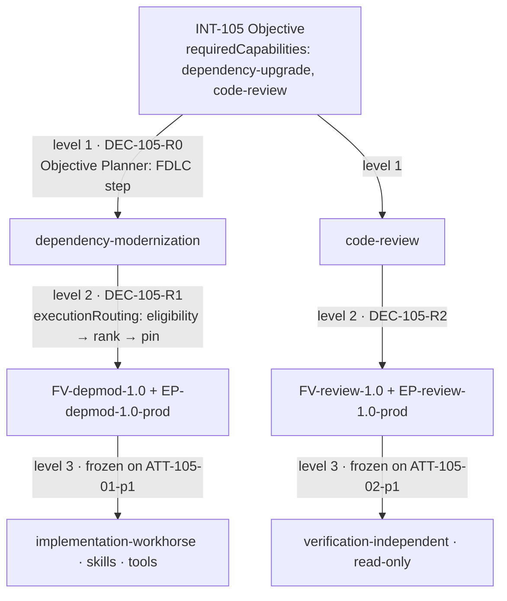

# Route an Objective Across Factories

## Goal

Take one Intent that needs two factories, decompose it into two Work Orders with a dependency, and route each to the right qualified Factory Version. At the end you have `INT-105` planned into `WO-105-01` (upgrade, on `FV-depmod-1.0`) and `WO-105-02` (review deliverable, on `FV-review-1.0`), three routing Decisions (`DEC-105-R0` at the Objective level, `DEC-105-R1` and `DEC-105-R2` at the Work Order level), and a frozen routing snapshot on every Attempt. You will also see exactly which of the three routing levels Mission Control implements today.

The control plane orchestrates the objective. Factories execute bounded work. Factories do not orchestrate one another ([/architecture/multi-factory](/architecture/multi-factory)).

## What you will have at the end

| Artifact | Id | Mission Control record |
|---|---|---|
| Intent / Objective | `INT-105` | `missions` |
| Plan with two blueprints and a dependency | `PLAN-105-r1` | `missionPlans` (`workOrderBlueprints[]`, `dependsOnBlueprintIds`) |
| Objective routing Decision (level 1) | `DEC-105-R0` (`level: 1`, `mode: HUMAN`) | FDLC-only record |
| Work Orders | `WO-105-01` (`SOFTWARE_CHANGE`, mutating, workflow `depmod-upgrade`), `WO-105-02` (`VERIFICATION`, non-mutating, workflow `code-review-verify`, depends on 01) | `workOrders` |
| Work Order routing Decisions (level 2) | `DEC-105-R1` → `FV-depmod-1.0`; `DEC-105-R2` → `FV-review-1.0` | `executionRoutingPin` + `modelRoutingDecisions` snapshot on each Attempt |
| Task routing (level 3) | frozen route per Attempt | `executionRoutingSnapshot`, `routingDecisionDigest` on `workflowRuns` |

## Prerequisites

- Tutorials 08 and 12 complete: `FV-depmod-1.0` and `FV-review-1.0` both active on the same repository.
- An advisory routing policy (tutorial 04 step 6).
- Two identities (Plan author and approver); `factory.approve` for pins.

## Concepts

- Three-level routing (D10): Objective → factory set; Work Order → Factory Version + Execution Profile; Task → model/skill/tool: [/architecture/routing](/architecture/routing).
- Objective dependency graph (D28) and decomposition: [/patterns/objective-decomposition](/patterns/objective-decomposition), [/specification/v1/plan](/specification/v1/plan).
- Capability-based routing and its invariants (eligibility before ranking; ineligible candidates never scored; hard budget with unknown cost fails closed; CRITICAL never auto-routed; fallbacks prequalified): [/patterns/capability-based-routing](/patterns/capability-based-routing).

**Mission Control status.** Level 2 (Work Order → active Factory Version in the same repository, eligibility before score, frozen decision snapshot, `ADVISORY` / `PINNED`, `GUARDED_AUTO` disabled) is Implemented, gated (`docs/architecture/execution-routing-v1.md`). Level 3 is realized by the frozen Execution Profile plus routing-policy lanes; no per-Task substitution happens at run time. Level 1, an Objective Planner that selects factories from `requiredCapabilities` across a registry, is Planned (audit §5.2–5.3); a Mission is bound to one repository and its Plan author chooses the workflow per blueprint by hand. Objective-level integration verification (`INTEGRATED_CANDIDATE`) is Planned (audit §5.5).



## Steps

### 1. Record the Objective with required capabilities

**FDLC step; Mission Control status: Partial (Mission has no `requiredCapabilities`).** Create the Mission as in tutorial 09 and carry the capabilities in `metadata` so the record is honest about where the decomposition came from:

```bash
npx convex run missions:createDraft '{"projectId":"<projectId>","idempotencyKey":"INT-105","title":"Upgrade acme-payments-sdk and review every touched call site","objective":"checkout-api on acme-payments-sdk 4.x, with an independent review deliverable covering every changed call site.","repositoryId":"<repositoryId>","codeScopeIds":["<codeScopeId>"],"executionEnvironment":"LOCAL","budgetUsd":40,"stopCondition":"Stop when the review deliverable is accepted or after three producer Attempts.","metadata":{"requiredCapabilities":["dependency-upgrade","code-review"],"objectiveRouting":"DEC-105-R0"}}'
```

### 2. Objective routing: choose the factory set

**FDLC step; Mission Control status: Planned.** The Objective Planner matches `requiredCapabilities` against the Factory Registry (manifest `capabilities[]`), filters by qualification scope, and emits the Work Order graph. With no registry, do it by hand and record the Decision so the choice is attributable:

```json
{
  "id": "DEC-105-R0", "kind": "routing", "subject": {"type": "fdlc://v1/intent", "id": "INT-105"},
  "actor": {"kind": "human", "id": "user:priya.n", "identitySource": "authenticated"},
  "riskClass": "MEDIUM", "outcome": "APPROVED",
  "routing": {"level": 1, "mode": "HUMAN", "algorithmVersion": "manual/1",
    "eligibilityFilters": [{"capability": "dependency-upgrade", "candidates": ["FM-depmod"], "qualifiedScope": "dependency-upgrade × staging × MEDIUM × L3"}, {"capability": "code-review", "candidates": ["FM-review"], "qualifiedScope": "code-review × staging × MEDIUM × L3"}],
    "eligibleCandidateIds": ["FM-depmod", "FM-review"],
    "workOrderGraph": [{"blueprintId": "BP-105-01", "factory": "dependency-modernization"}, {"blueprintId": "BP-105-02", "factory": "code-review", "dependsOn": ["BP-105-01"]}]},
  "rationale": "Two capabilities, two qualified factories on repo:checkout-api; review depends on the upgrade candidate.",
  "state": "DECIDED", "idempotencyKey": "INT-105:routing:1:1"
}
```

### 3. Plan two blueprints with a dependency

Mission Control's Plan carries the decomposition: `workOrderBlueprints[]` with `role: WORKER | VALIDATOR`, `isMutating`, a `workflowId` per blueprint, and `dependsOnBlueprintIds` (`convex/missions.ts`, `blueprintInput`; `convex/lib/missionPlan.ts` validates the graph). The workflow on each blueprint is what makes level-2 routing find the right factory: candidates are filtered by `workflowMatches: version.workflowId === workflow._id` (`convex/lib/executionRouting.ts`).

```bash
npx convex run missions:savePlanDraft '{"projectId":"<projectId>","missionId":"<missionId>","idempotencyKey":"PLAN-105-r1","summary":"Upgrade first, then an independent review deliverable over the exact upgrade candidate.","rollbackApproach":"Revert the upgrade commit; the review deliverable is non-mutating.","estimatedCostUsd":40,"assertions":[{"assertionId":"AS-105-01","title":"Behavior preserved","outcome":"CT-* and IT-* pass on the exact candidate.","verificationMethod":"TEST","passCondition":"Independent verifier Attempt records TEST_RESULT PASS.","requiredEvidence":"Subject digest, verifier Attempt, receipt.","requiresIndependentValidation":true,"waiverAllowed":false},{"assertionId":"AS-105-02","title":"Every touched call site reviewed","outcome":"A REVIEW_RESULT lists every changed call site with a finding or an explicit no-finding.","verificationMethod":"CHECKLIST","passCondition":"Review findings cover 100% of changed call sites.","requiredEvidence":"REVIEW_RESULT envelope bound to the candidate.","requiresIndependentValidation":true,"waiverAllowed":false}],"workOrderBlueprints":[{"id":"BP-105-01","title":"Implement bounded SDK v4 upgrade","desiredOutcome":"checkout-api on acme-payments-sdk 4.x with unchanged public API, schema, and authorization behavior.","workflowId":"depmod-upgrade","sequence":1,"role":"WORKER","isMutating":true,"priority":2,"riskLevel":"MEDIUM","constraints":["Keep the sync client"],"requiredApprovals":[],"estimatedCostUsd":25,"implementationPolicy":{"allowedCommands":["pnpm install","pnpm test --filter checkout-api"],"independentVerification":{"executable":"pnpm","args":["test","--filter","checkout-api","--","--grep","CT-|IT-"],"category":"INTEGRATION_TEST","commandClass":"TEST","evidenceCategory":"TEST_RESULT","timeoutMs":1200000},"maxFilesChanged":40,"maxLinesChanged":1200,"maxCostUsd":25,"maxAttempts":3,"timeoutMinutes":90,"stopCondition":"Stop after three Attempts."},"dependsOnBlueprintIds":[],"assertionIds":["AS-105-01"]},{"id":"BP-105-02","title":"Review every touched call site","desiredOutcome":"A structured review of the exact upgrade candidate covering every changed call site.","workflowId":"code-review-verify","sequence":2,"role":"VALIDATOR","isMutating":false,"priority":2,"riskLevel":"LOW","constraints":["Read-only"],"requiredApprovals":[],"estimatedCostUsd":10,"dependsOnBlueprintIds":["BP-105-01"],"assertionIds":["AS-105-02"]}]}'
npx convex run missions:submitPlan '{"projectId":"<projectId>","missionId":"<missionId>","planId":"<planId>","idempotencyKey":"PLAN-105-r1:submit"}'
npx convex run missions:approvePlan '{"projectId":"<projectId>","missionId":"<missionId>","planId":"<planId>","decisionReason":"Two-factory decomposition reviewed; review depends on the upgrade candidate.","idempotencyKey":"PLAN-105-r1:approve"}'
npx convex run missions:start '{"missionId":"<missionId>","idempotencyKey":"INT-105:start"}'
```

Approval releases both Work Orders. `WO-105-02` is a `VALIDATOR` Work Order: non-mutating, with no change budget. Dispatch enforces the dependency strictly: a dependent Work Order is admissible only when every predecessor is `DONE` and has a `COMPLETE` handoff with no incomplete or unknown assertions (`convex/workOrders.ts`, `predecessorHandoffValid`; `missions:recordHandoff`). The Mission's `SERIAL_MUTATIONS` policy also guarantees only one mutating Work Order is active at a time.

### 4. Work Order routing: preview, read the filters, pin

FDLC requires eligibility (policy, authorization, compatibility, qualification, authority, budget, capacity) to be filtered before any ranking, and the Decision to record rejected candidates with reasons. Mission Control's preview returns every candidate active version in the repository with its eligibility booleans and rejection codes, then scores only eligible ones with `execution-routing/v1` (`convex/lib/executionRouting.ts`):

```bash
npx convex run executionRouting:previewForWorkOrder '{"workOrderId":"<WO-105-01 id>"}'
npx convex run executionRouting:previewForWorkOrder '{"workOrderId":"<WO-105-02 id>"}'
```

Read the `eligibility` block per candidate: `factoryActive`, `factoryVersionActive`, `readiness`, `readinessCurrent`, `readinessDigestMatches`, `workflowMatches`, `repositoryMatches`, `repositoryAccess`, `workerEligible` (+ `workerReason`), `harnessCapabilitiesSatisfied`, `harnessModelSupported`, `backendSupported`, `isolationSupported`, `networkPolicySatisfied`, `credentialPolicySatisfied`, `modelApproved`, `modelAvailable`, `productionCertified`. For `WO-105-01`, `FV-review-1.0` appears with `workflowMatches: false` and no score; for `WO-105-02`, `FV-depmod-1.0` is rejected the same way. An ineligible candidate never receives a score.

Pin each Work Order to its version and record the Decision:

```bash
npx convex run executionRouting:setPinnedTuple '{"workOrderId":"<WO-105-01 id>","factoryDefinitionVersionId":"<FV-depmod-1.0 row id>","reason":"DEC-105-R1: sole eligible candidate for depmod-upgrade; scope inside qualified staging × MEDIUM × L3."}'
npx convex run executionRouting:setPinnedTuple '{"workOrderId":"<WO-105-02 id>","factoryDefinitionVersionId":"<FV-review-1.0 row id>","reason":"DEC-105-R2: sole eligible candidate for code-review-verify; read-only."}'
```

An ineligible pin blocks dispatch rather than being overridden: pinning is ranking authority only, and eligibility is re-evaluated at dispatch and again at the first worker claim.

### 5. Task routing: what the Attempt freezes

FDLC's level 3 chooses model, skill, tool, runtime, and sandbox per step. Mission Control does not choose at run time; it freezes what the Execution Profile already admitted. When you dispatch `WO-105-01`, the Attempt carries `executionRoutingSnapshot` (algorithm and schema version, policy version, risk, evidence cutoff, every candidate tuple with digests, every rejection code, observed metrics, weights, normalized scores, evidence coverage, recommended/applied/fallback keys, mode) and `routingDecisionDigest` (`docs/architecture/execution-routing-v1.md`, "Frozen decision record"). The policy's lane rules (`modelRoutingPolicies:simulate` with `operatingLane: EXECUTE` or `REVIEW`) show which route a lane resolves to, but the profile's frozen route is what runs.

```bash
./scripts/mc dispatch <WO-105-01 id> depmod-upgrade
./scripts/mc run-summary <runId>          # executionRoutingSnapshot, routingDecisionDigest, executionManifest
```

Later telemetry cannot update that Attempt's snapshot; verification outcomes become evidence only for future decisions.

### 6. Dispatch the dependent Work Order after the predecessor is accepted

When `WO-105-01`'s producer Attempt reaches candidate-ready, the control plane schedules the independent verifier Attempt for `WO-105-01` on `FV-review-1.0` (tutorial 12; that is verification of Work Order 01, not the review deliverable). Accept `WO-105-01` as a human and record its handoff; only then does `WO-105-02` pass the dependency gate. Dispatch it with the `code-review-verify` workflow; its Attempt reads the exact accepted candidate as a read-only input and produces the review deliverable, which is then itself verified against `AS-105-02`.

```bash
./scripts/mc accept <WO-105-01 id>
npx convex run missions:recordHandoff '{...}'          # COMPLETE handoff for WO-105-01; args in convex/missions.ts
./scripts/mc dispatch <WO-105-02 id> code-review-verify
```

Two factories worked on one objective; neither called the other; the Plan's dependency and the control plane's scheduling did the coordination ([/anti-patterns/agent-to-agent-spaghetti](/anti-patterns/agent-to-agent-spaghetti)).

### 7. Objective-level verification

**FDLC step; Mission Control status: Partial.** FDLC L5 adds an integration Verification Subject over the integrated candidate across Work Orders (`INTEGRATED_CANDIDATE`). Mission Control's Mission tier reconciles `validationAssertions` from Work Order receipts (`AS-105-01`, `AS-105-02` reach 2/2) and `missions:recordValidationResult` records a Mission-level result; there is no multi-candidate subject. Accept both Work Orders (`./scripts/mc accept`), then `missions:accept`.

### 8. Guarded Auto stays off

When the evidence window holds at least five verified Attempts, 60% evidence coverage, and a five-point margin, a human may promote the policy (`executionRouting:promoteGuardedAuto` with reviewed decision ids), and a separate flag `execution-routing.guarded-auto` enables it at run time. Leave both off for this tutorial. RED Work Orders are never auto-routed regardless. Autonomy increases only as verification confidence increases ([/patterns/progressive-autonomy](/patterns/progressive-autonomy)).

## Verify

| Check | How |
|---|---|
| Decomposition is attributable | `PLAN-105-r1` blueprints carry `workflowId` per factory and `dependsOnBlueprintIds`; `DEC-105-R0` names the capability → factory mapping |
| Eligibility preceded ranking | In each preview, the ineligible version has rejection codes and no score; only eligible candidates carry `score` |
| Each Work Order bound to the right version | `workOrders:get` shows `executionRoutingPin.factoryDefinitionVersionId` = depmod for 01, review for 02, with `pinnedBy` and `reason` |
| Routing is frozen on the Attempt | `workflowRuns` rows carry `routingDecisionDigest` and `executionRoutingSnapshot`; `modelRoutingDecisions` has matching `decisionDigest` and `mode: ENFORCED` or `SHADOW` |
| Dependency enforced | Dispatching `WO-105-02` before `WO-105-01` is `DONE` with a `COMPLETE` handoff is refused (`workOrders:readiness` check `mission-controls` names the reason); `SERIAL_MUTATIONS` never lets two mutating Attempts run |
| No factory-to-factory call | Neither workflow references the other; scheduling lives in the control plane |
| Guarded Auto disabled | `modelRoutingPolicies:getActive` mode `ADVISORY`; `./scripts/mc flags` shows `execution-routing.guarded-auto` off |

## Common problems

| Symptom | Cause | Fix |
|---|---|---|
| Preview shows one candidate only | The other version's workflow differs; expected | Routing is per workflow; the Plan chose the factory |
| `Factory Version is unavailable or outside the WorkOrder scope.` on pin | Version's repository or workflow differs from the Work Order's | Pin the version whose `workflowId` matches |
| `Only an active exact Factory Version can be pinned.` | Definition not active or pointer elsewhere | Activate (tutorial 08) |
| `Cancel or complete the active Attempt before changing its execution route.` | Re-routing mid-Attempt | Not allowed; a running Attempt keeps its frozen route |
| You want one Intent across two repositories | Missions are single-repository | Tutorial 14; multi-repository Missions are Planned |
| Score prefers the cheaper version with unknown cost | It cannot; unknown components contribute no favorable score and a hard budget with unknown cost fails closed | Read the snapshot's `observed: false` components |

## Next tutorial

[Scale across repositories](/tutorials/scale-across-repositories) — the same factory over many repositories with per-repository qualification.

## Related

- Guide: [/guides/multi-factory-workflow](/guides/multi-factory-workflow)
- Spec: [/specification/v1/plan](/specification/v1/plan) · [/specification/v1/work-order](/specification/v1/work-order) (`binding`, `dependsOnWorkOrderIds`) · [/specification/v1/decision](/specification/v1/decision) (`routing`)
- Architecture: [/architecture/routing](/architecture/routing) (D10) · [/architecture/multi-factory](/architecture/multi-factory) (D09, D28)
- Patterns: [/patterns/objective-decomposition](/patterns/objective-decomposition) · [/patterns/capability-based-routing](/patterns/capability-based-routing) · [/patterns/multi-factory-orchestration](/patterns/multi-factory-orchestration) · [/patterns/model-routing](/patterns/model-routing) · Anti-pattern: [/anti-patterns/agent-to-agent-spaghetti](/anti-patterns/agent-to-agent-spaghetti)
- Mission Control: `docs/architecture/execution-routing-v1.md`; `convex/lib/executionRouting.ts`; ledger row "Model/harness/backend routing — Implemented, gated"; audit §5.2–5.5
- Glossary: Objective, Objective Planner, Factory Router, Capability Router, Eligibility, Guarded Auto
