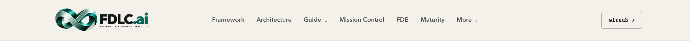
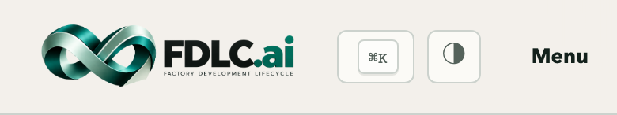

# Global header logo

`public/fdlc-logo-transparent.png` is the canonical header asset, owned by FDLC and consumed by both FDLC and the Guide microfrontend. Keep the original opaque asset for existing consumers and the footer.

The original 2007×784 PNG contained a cream studio background and cast shadow. Its combination with brightness/multiply styling created the visible rectangle. The transparent asset was extracted from the original using deterministic, seeded segmentation and local alpha matting. No generative output, redrawn artwork, new type, resizing, or recoloring is included. The infinity ribbon's dimensional shading remains part of the artwork; the surrounding floor shadow is removed. Fully opaque pixels retain their original RGB values. Fractional edge pixels remove the original background contribution to avoid cream fringing.

The alpha and source-preservation measurements and SHA-256 hashes are recorded in `header-logo-verification.json`. Native dimensions, layout proportions, home-link accessibility, header backgrounds and spacing remain unchanged. FDLC uses `sizes="220px"` for appropriate Next/Image responses. Guide declares intrinsic dimensions and retains its existing dark-mode contrast filter while removing the obsolete blend mode.

Local native-build qualification covered 1440×900 and 390×844 at device pixel ratio 2 on home, Framework, Architecture, Guide, a deep chapter, Atlas, Reference, Glossary, Search, Mission Control, FDE (`/deploy`), and Maturity. All 24 visits passed: zero image-boundary pixel differences, header layout shifts, horizontal overflow, console errors, or page errors. Keyboard home-link focus, navigation disclosures, Guide theme switching, and visual inspection also passed. The screenshots below illustrate the asset on the actual header backgrounds.

These are local qualification records. Production release acceptance is recorded separately after deployment.
