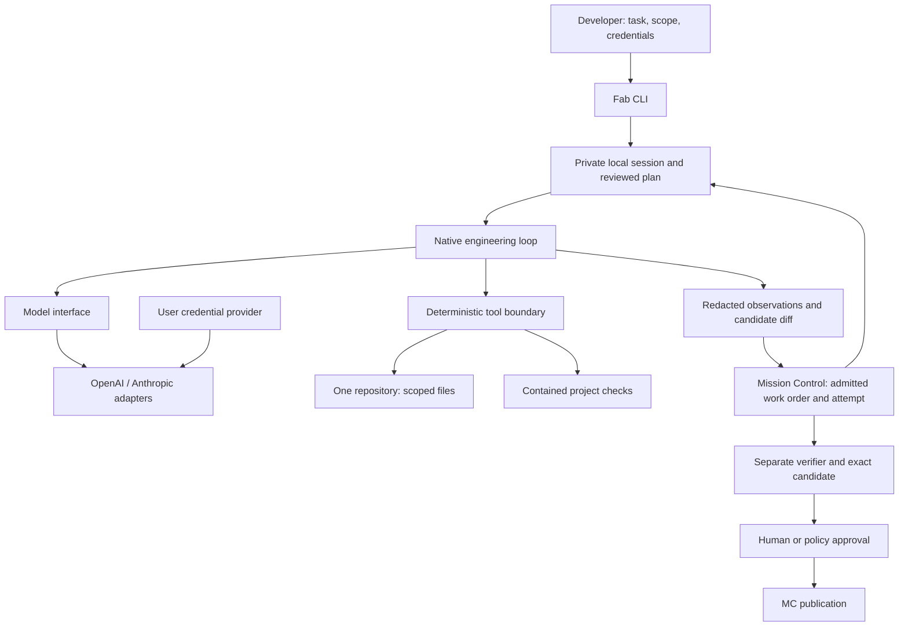

# Fab architecture

Phase B, 2026-09-05. Design accepted for a reversible local implementation by the build request. Runtime maturity is tracked in `FAB-QUALIFICATION.md`; diagrams describe the target boundary, not completed integrations.

Fab means **Factory Agent Builder**. FDLC defines the factory; Fab does the building. The local runtime produces a candidate, never acceptance.

## Components and ownership

FDLC remains framework/content; Guide remains doctrine; Factory Engineer produces verified intent and acceptance criteria. Fab interprets a bounded task in one codebase. MC owns execution authority, distributed attempts/leases/recovery, remote workers, independent verification, governed evidence, approvals and publication.

## Runtime and package decision

Use a strict TypeScript Node package with no site or Convex runtime dependency and no new service/database. Stage under `packages/fab` without converting FDLC into a workspace monorepo. CLI and programmatic callers share the same runtime. A separate repository/release is recommended after qualification; no code moves or publication occur in this phase.

Alternatives: embedding in MC simplifies private imports but ties installation to control-plane dependencies; embedding in the site couples unrelated releases; publishing shared contracts now prematurely freezes interfaces. The staged independent package preserves reversibility. Later extract/share only stable contracts with conformance coverage, not duplicate services.

## Trust and execution

An explicit operator configuration supplies root, readable/writable file scope, fixed validation commands, model/profile, credential reference and resource limits. Repository files are untrusted context and never supply execution policy. No automatic `.env`, Git credential helper, cloud profile, browser login or MCP discovery.

A planning stage can read bounded context and emits an inspectable plan. Write execution requires a digest binding task, root/revision, scope, checks, model/configuration and plan. Drift invalidates consent. The model selects engineering actions; the dispatcher validates exact arguments and intersects tools with stage/scope. It cannot invoke credentials, modify policy, install dependencies, run an arbitrary shell, publish or certify acceptance.

File access rejects traversal, absolute paths, symlinks, hard links, secret/config internals and oversized/binary inputs. Writes require exact allowed files and optimistic content hashes. Local Git operations are read-only with external diff/textconv/hooks/credential prompting disabled. Initial runs require a clean committed repository; worktree allocation remains a future developer convenience and an existing MC responsibility.

Check execution must be OS-contained or fail closed. Use a disposable, secret-filtered repository snapshot with an empty home/environment; project check code never receives model credentials. Source and Git metadata in the user's repository remain unavailable for check writes. The pilot denies child processes entirely (Node tests use `--test-isolation=none`) to prevent detached daemons escaping process-group cleanup. A native supervisor watches a pipe held by Fab; parent death terminates the active check and removes its snapshot independently of the agent timer/finally block. Timeout and cancellation use the same cleanup path. Snapshot/check result is bound to candidate content, and subsequent edits invalidate previous check success. External sandbox support is an explicit platform gate.

## Model interface versus agent interface

`ModelProvider.invoke(messages, tools, signal)` returns validated text, tool calls, finish reason and nullable usage. Message unions preserve assistant calls and corresponding tool results. Adapters own wire format, endpoint allowlist, transport timeout, bounded retry policy and provider errors. No silent provider/model substitution. Streaming support is explicitly reported; event progress can work without token streaming. Reasoning, multimodal input and dynamic model discovery are deferred.

OpenAI Chat Completions and Anthropic Messages are the first adapter paths because MC already has both. These are protocol implementations, not qualified model claims. Require an explicit model ID. Do not inherit MC's historic prices or advertise all model IDs as compatible. Primary wire references: [OpenAI Chat API](https://developers.openai.com/api/reference/resources/chat), [Anthropic Messages API](https://platform.claude.com/docs/en/api/messages/create), inspected 2026-09-05.

MC's `HarnessExecutorAdapter` is a different seam: capabilities, validateConfiguration, estimate, prepare, execute, collectResult, cancel, cleanup and health. A Fab adapter must import `generic-harness-contract/v1`, advertise all canonical authorities as `NONE`, pin an effective manifest/configuration, honor scope/timeouts/read containment and produce `harness-result/v1`. A local evidence JSON file alone does not implement that contract.

## Credentials

`CredentialProvider` exposes metadata and a use-at-boundary operation for an explicitly bound reference, not secret fields in session state. User, organization, repository and execution scopes are distinct tagged records. Resolve only a reference bound to the local actor/provider/root (later MC attempt). Environment access is opt-in by exact variable name; native macOS Keychain storage supports masked interactive enrollment. No ambient fallback. Hosted credentials require tenant ownership checks and envelope encryption backed by KMS; hosted storage is designed, not implemented.

One redactor handles known credential values and common encodings, generic token/private-key patterns, prompts, model/tool outputs, evidence, diffs and CLI errors. Authentication headers exist only in transport memory. Errors are metadata-only. See `FAB-SECURITY.md` for limits.

## Session and evidence data

Versioned local session: ID, actor, repository root/HEAD/branch, task and acceptance criteria, policy/configuration digest, plan/digest, provider/model, credential reference, status, timestamps, messages, event sequence, tool observations, files read/modified, check results, nullable token/cache/cost fields, retries, durations and candidate content/diff digest. Candidate revision is null until a commit exists; a content digest is not misrepresented as a Git revision.

States: planning → awaiting approval → executing → candidate, failed, cancelled, or blocked. Persist checkpoints outside the repository with owner-only permissions and atomic replacement. A local lock prevents concurrent writers. Resume must detect interrupted mutations and repository/configuration drift; ambiguous operations are not replayed automatically. Preserve partial diffs on failure; never destructive rollback of unrelated work.

Evidence records observations with `independent: false` and `acceptance: not_evaluated`. A passing test command is not acceptance-criterion proof. Acceptance mapping identifies observed checks and remaining human review, never invents verifier results. Unknown cost/tokens remain null. Local integrity digests detect accidental corruption; they do not make user-owned storage tamper-proof.

## Governed contract and integration sequence

1. The experimental MC adapter now implements this sequence offline; deployment and live qualification remain gated. MC freezes work order, acceptance criteria, quality/verification contract, repository baseline and admitted Fab configuration.
2. MC claims its own lease and provides its scoped local worktree. The local adapter resolves only the operator's explicitly selected Fab credential. Remote sandbox execution and short-lived native-provider grants through MC's broker remain unimplemented.
3. Its Fab harness adapter translates only execution requests and observations. Fab cannot alter grants, manifest or work-order state.
4. MC independently captures candidate content and evidence, runs its existing fresh-context/separate-attempt verifier and checks exact-current identity.
5. Existing human/policy approval and GitHub App publisher determine publication. Fab provides no standalone `pr` or authoritative `verify` shortcut.

No new HTTP endpoints, browser bridge, work-order tables, approval system or remote shell. Canonical adapter conformance and negative admission tests pass offline; production admission remains gated by the unqualified deployment and containment boundaries.

## Phase 2 implementation boundary

MC's generic execution context now carries optional Attempt identity, frozen criteria/source and an authority checkpoint. Fab requires it. The existing worker renews the canonical lease before each Fab model/tool action and propagates cancellation; no new lease service exists. MC records the candidate commit back into the Fab session only if its content matches the digest checked by Fab. Atomic session reservation refuses repeated execution IDs after crashes. Developer-mode commands cannot resume a governed session without MC's authority callback.

The adapter lives in the separate MC `codex/fab` worktree and imports the pinned private Fab package. Registration is off by default. Configuration and the exact selected environment credential are captured before MC's legacy dotenv loading. The tuple supports bounded local persistent workers; it rejects whole-agent WORKSPACE_ONLY requests and advertises partial filesystem isolation. Remote sandbox and hosted secret grants are not claimed.

The deterministic integration uses the real MC registry, eligibility function, worker, candidate routines, detached verifier worker, frozen verification plan and independence derivation. Convex/GitHub transports are fixtures. MC's canonical policy-v2 Git verification subject requires a PR identity; the test supplies a controlled fixture identity. A deployed pre-publication verification route is not established by this fixture. Existing MC draft-publication/currentness policy is unchanged.
